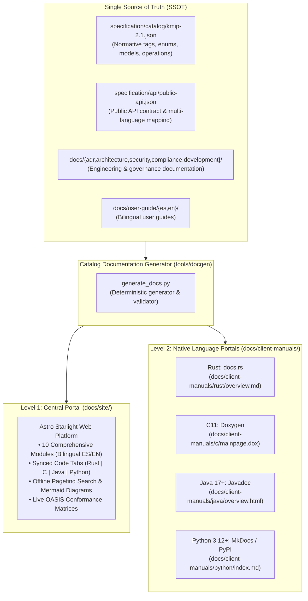

# Documentation Architecture

Status: Approved Architecture Baseline  
Date: 2026-11-07  

## 1. Context and Problem Statement

`KMIPKit` is an enterprise cryptographic infrastructure client library targeting four programming languages (Rust, C, Java, Python) with functional parity. Because KMIP protocol operations, wire encodings (TTLV, JSON, XML), and multi-language bindings have a large public surface, conventional documentation approaches suffer from three acute failure modes:

1. **Drift and Desynchronization**: Code comments, web pages, and native package manuals diverge over time when written manually.
2. **Context Pollution**: Native client developers on `docs.rs`, `pkg.go.dev`, or PyPI are overwhelmed by internal Rust workspace mechanics and Spec Kit repository processes rather than idiomatic client usage.
3. **Unverified Examples**: Code snippets in documentation break silently when APIs evolve.

## 2. Decision: Two-Level Documentation Architecture

KMIPKit adopts a strictly governed **Two-Level Documentation Architecture** driven by a **Single Source of Truth (SSOT)**:



### Level 1: Central Documentation Portal (`docs/site/`)
Deployed via GitHub Pages using Astro Starlight:
- **Scope**: Complete project and protocol encyclopedia.
- **Ten Modules**:
  1. Getting Started (3-minute quickstart without physical HSM).
  2. Installation & Deployment (package managers, C ABI, Docker, compilation).
  3. Testing & `kmipkit-test-server` (multi-version 1.0..2.1 simulation, chaos injection, wire inspection).
  4. KMIP Protocol Encyclopedia (NIST state machine, TTLV binary framing, KMIP 1.x vs 2.1).
  5. Operations Dictionary (interactive references for client and server operations with wire traces).
  6. Production Cookbook (mTLS, transaction batching with `IDPlaceholder`, streaming, async operations).
  7. HSM & KMS Interoperability Guides (Thales, Utimaco, Kryptus, Entrust, Vault, Fortanix).
  8. Internal Workspace Architecture (crate responsibilities, C ABI panic containment, JNI/CFFI bridges).
  9. Security & Threat Model (zeroization, resource limits, anti-OOM bounds, error redaction).
  10. OASIS Conformance & Governance (test matrix, ADRs 0001..0020, contribution guide).
- **Interactive Capabilities**:
  - Synced code tabs: Selecting a language (e.g., Rust, C, Java, Python) in any code block synchronizes all code blocks across the portal and persists the choice in `localStorage`.
  - Native Mermaid diagrams: Render NIST key state transitions, mTLS handshakes, and layered architecture dynamically.
  - Pagefind offline search: Instant local indexing across tags (`0x420079`), operation names, and error codes.
  - Full bilingual parity: Complete mirrors in Spanish (`es/`) and English (`en/`).

### Level 2: Native Language Platforms (`docs/client-manuals/`)
Applies the **Strict Separation Rule**: native package documentation covers **exclusively** how to consume KMIPKit as a client in that specific language. Internal Rust workspace structure, Spec Kit processes, and physical HSM internals are excluded and replaced with deep-links to the Central Portal.

Every native client manual implements an identical 6-section template:
1. Installation and OS Requirements.
2. Quickstart (Ready-to-run key generation, encrypt/decrypt, destroy).
3. Connection and Transport (`Raw TLS 1.3 mTLS` and `HTTPS/1.1 mTLS`).
4. Client Method Catalog (High-level builders, typed models, generic TTLV).
5. Error Handling & Secret Zeroization (`NotSent`, `PossiblySent`, `ResponseStarted`).
6. Local Testing (`kmipkit-test-server` integration).

## 3. Directory Layout and Repository Integration

All documentation, portals, and templates reside under the top-level `docs/` directory:

```text
docs/
├── architecture/documentation-architecture.md  # This document
├── site/                                      # Level 1: Astro Starlight Web Portal
│   ├── package.json
│   ├── astro.config.mjs
│   ├── src/content/docs/
│   │   ├── es/                                # Spanish Portal Content (10 Modules)
│   │   └── en/                                # English Portal Content (10 Modules)
└── client-manuals/                            # Level 2: Native Manual Templates
    ├── rust/                                  # docs.rs facade overview
    ├── c/                                     # Doxygen configuration & mainpage
    ├── java/                                  # Javadoc overview
    └── python/                                # MkDocs / PyPI client overview
```

## 4. Single Source of Truth & Zero-Drift Pipeline

1. **Protocol tables and operations reference**: Automatically generated from `specification/catalog/kmip-2.1.json` using `tools/docgen/generate_docs.py`.
2. **Deterministic execution**: `cargo xtask docgen --check` verifies that all generated operation references, tables, and native docstrings match the normative catalog. Any manual edits or out-of-sync files fail in CI.
3. **Polyglot Doctests**: Snippets published in client manuals are compiled against `crates/kmipkit` and `crates/kmipkit-test-server` to eliminate broken documentation.
