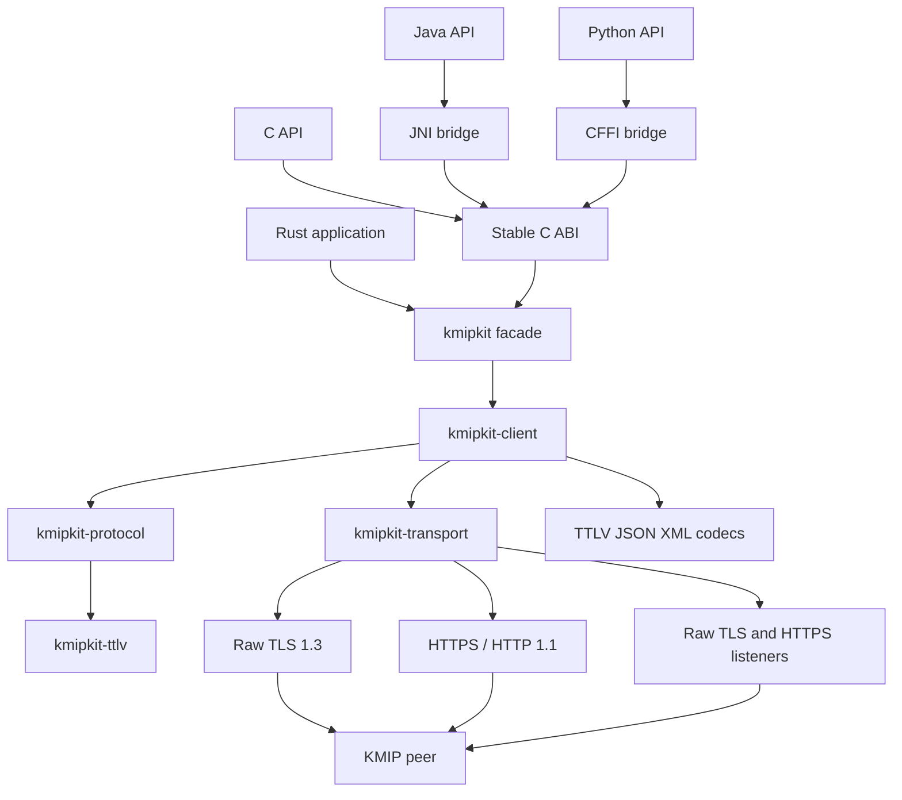

# Architecture overview

This page describes the architecture present in the reviewed
`release/1.0.0` snapshot and its governing boundaries. For release evidence
and qualifications, see the [project status](../project-status.md). Code
integration does not itself establish profile conformance or publication
readiness.

## System shape



Rust owns protocol semantics. C, Java, and Python adapt types, ownership,
errors, and runtime conventions across the stable C ABI; they do not implement
separate KMIP behavior. TTLV is the default encoding. KMIP 2.1 is the default
protocol version; supported edition-specific behavior is gated by the
normative catalog and approved specifications.

## Workspace layout

```text
crates/
  kmipkit-ttlv/          Ordered generic TTLV model and bounded codec
  kmipkit-protocol/      KMIP models, values, catalog output, validation
  kmipkit-transport/     Raw TLS/HTTPS exchanges and listener contracts
  kmipkit-client/        Synchronous typed execution and dispatch
  kmipkit/               Supported Rust facade
  kmipkit-ffi/           Stable C ABI; only crate permitted unsafe code
  kmipkit-test-support/  Fakes, fixtures, and test PKI; not published
  kmipkit-test-server/   Standalone KMIP test server
bindings/
  c/
  java/                  JNI adapter and Java API
  python/                CFFI adapter and Python API
interop/                 Shared schemas and four language validators
proxy/
  kmipkit-proxy/         Separate stateless KMS proxy workspace
specification/
  oasis/                 Immutable upstream source copies
  catalog/               Reviewed machine-readable normative catalog
  compliance/            Requirement traceability and profile evidence
tools/                   Catalog, API manifest, and repository tooling
docs/
fuzz/
```

The eight crates live in the core Cargo workspace. The proxy has an independent
workspace and dependency boundary. Runtime crate publication and synchronized
package versions are governed by the release documentation.

## Layer responsibilities

### `kmipkit-ttlv`

Provides catalog-aware tags, an ordered generic item tree, typed values,
bounded decoding, structure views, and the model used by the private wire
codecs. Decoder limits are enforced before resource-consuming work. Unknown
and vendor data can be retained where the approved API permits it.

### `kmipkit-protocol`

Provides generated protocol values and typed models for messages, credentials,
objects, attributes, operations, and responses. It performs structural and
schema-aware validation, version gating, profile validation, and conversion to
and from generic items. Edition-specific support is bounded by approved specs;
the KMIP 3.0 surface does not imply general conformance.

### `kmipkit-transport`

Provides raw TLS and HTTPS/HTTP 1.1 client transports, bounded listener
transports, a public exchange contract, delivery-state errors, timeout and
connection handling, TLS configuration, and zeroizing response ownership.
Security configuration enforces TLS 1.3 mutual authentication and peer
verification. Proxies, redirects, compression, TLS 0-RTT, and key logging are
disabled for the core client.

### `kmipkit-client`

Provides synchronous typed request execution, batch processing, protocol
asynchronous outcomes, explicit encoding and version selection, pre-send
validation, typed response access, extension handling, and server-to-client
dispatch/listener integration under KMIPKIT-0066. Calls are serialized through
the configured worker. The caller decides whether to issue a later request;
automatic KMIP retries, failover, and background polling are not performed.

TTLV, JSON, and XML encoding paths share the ordered generic item model and
checked-in catalog metadata. TTLV remains the default.

### `kmipkit`

Provides the supported Rust facade, high-level operation APIs, configuration,
results, errors, secret types, and reexports of supported protocol and TTLV
surfaces.

### `kmipkit-ffi` and language adapters

The C ABI uses opaque handles, fixed-width types, stable error codes, explicit
ownership, and panic containment. Java uses JNI and Python uses CFFI. Their
feature surfaces are reconciled through the versioned public API manifest and
parity verification. Runtime limitations on external secret copies are
documented in the language guides.

### Test server, interoperability tools, and proxy

The test server supplies configurable protocol peers and fixtures for client
and listener tests. The standalone validators in `interop/` use shared
catalogs, schemas, vectors, and server profiles. A validator passing its own
workflow is not evidence that a KMIPKit client has interoperated with every
listed server or operation.

The proxy under `proxy/kmipkit-proxy` is an independent stateless service with
provider-specific bridges. It is not linked into the core client facade or
foreign-function runtime packages.

## Message flow

1. The caller builds a typed request or batch and selects any non-default
   encoding or protocol version explicitly.
2. The client applies local structural, schema, profile (when requested), and
   version validation before writing.
3. The private codec emits a bounded request. Public APIs do not expose
   arbitrary raw-message submission as a substitute for typed execution.
4. The configured transport performs one exchange over raw TLS or HTTPS.
   Listeners accept and dispatch the approved server-to-client operations.
5. The client bounds and decodes the response, checks request/response
   relationships, and returns typed outcomes with delivery-state details on
   transport failure.
6. Pending protocol outcomes and subsequent operations remain caller-driven.
   KMIPKit does not automatically retry, fail over, or poll.

## Dependency rules

- Dependencies point downward through the layers shown above.
- TTLV cannot depend on protocol or transport.
- Protocol cannot perform network I/O.
- Transport cannot depend on high-level operation semantics.
- Bindings cannot contain KMIP business rules.
- Test support and test-server code cannot become a runtime dependency of
  published client crates.
- Vendor extensions cannot access transport internals.
- The proxy remains isolated from the core client and binding dependency graph.

See the [architecture decisions](../adr/README.md) and
[transport security architecture](transport-security.md) for detailed
contracts.
