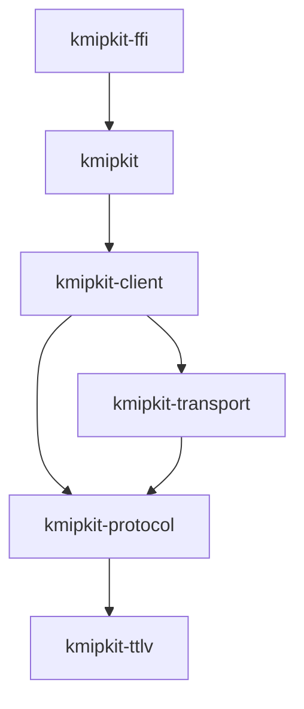

# 02. Architektur & Sicherheitsmodell

KMIPKit ist für regulierte Unternehmensumgebungen konzipiert (Banken, Zahlungs-HSMs, souveräne Clouds und hochsichere Schlüsselverwaltung). Jede Crate-Grenze, Speicherbesitzregel und Transportinvariante wird zur Kompilierzeit erzwungen und automatisiert geprüft.

---

## 1. Geschichtete Workspace-Architektur

Das Repository ist in **zwei strikt isolierte Cargo-Workspaces** unterteilt:

```text
KMIPKit/
├── crates/                     # Core Client Workspace (8 Crates)
│   ├── kmipkit-ttlv/           # Begrenztes, geordnetes generisches TTLV-Modell & Codec
│   ├── kmipkit-protocol/       # Normativer Katalog, typisierte Modelle, Schemavalidierung, Versions-Gates
│   ├── kmipkit-transport/      # Produktions-mTLS-Adapter (Raw TLS & HTTPS/1.1), Zeroizing-Puffer
│   ├── kmipkit-client/         # Synchrone Ausführung, atomare Batches, Async-Ergebnisse, S2C-Listener
│   ├── kmipkit/                # Öffentliche Rust-Fassade & ergonomische Fluent Builder
│   ├── kmipkit-ffi/            # Stabile C11-ABI (EINZIGE Crate mit `unsafe`-Erlaubnis)
│   ├── kmipkit-test-support/   # Ephemere PKI, geskriptete Transporte, Fixtures (unveröffentlicht)
│   └── kmipkit-test-server/    # Eigenständiger Multi-Versions-KMIP-Testserver
├── bindings/                   # Native Sprachadapter
│   ├── c/                      # C11-Header, CMake, ABI-Consumer-Tests
│   ├── java/                   # C++-JNI-Bridge + idiomatische Java-17-API
│   └── python/                 # CFFI-Bridge + typisierte Python-3.12-API
└── kmip-proxy/                 # Unabhängiger Standalone-Proxy-Workspace
    ├── src/providers/          # 10 Cloud-/Enterprise-KMS-Brücken
    └── src/kmip1x/             # Übersetzungsbrücke KMIP 1.0–1.4 <-> KMIP 2.0/2.1/3.0
```

### Strikte Abhängigkeitsrichtung



* `kmipkit-proxy` besitzt eigene `Cargo.toml`- und `Cargo.lock`-Dateien, sodass Cloud-SDK-Abhängigkeiten (`aws-sdk-kms`, `azure_security_keyvault_*`, `reqwest` usw.) **niemals** in die Kernbibliothek oder C/Java/Python-Pakete gelangen.

---

## 2. Drei unterstützte API-Ebenen

KMIPKit bietet drei komplementäre API-Stufen — abrufbar über `kmipkit::api_levels()` (Rust), `kmipkit_api_levels_get_v1` (C), `RuntimeMetadata.apiLevels()` (Java) und `kmipkit.metadata.get_api_levels()` (Python):

| API-Ebene | Zweck | Optimal für |
| :--- | :--- | :--- |
| **1. High-Level Fluent** | Aufgabenorientierte Builder (`create_symmetric_key()`, `encrypt()`, `activate()`, `revoke()`) | 90 % aller Enterprise-Anwendungsintegrationen. |
| **2. Typed Protocol** | Explizite `ClientBatch`, `ClientBatchItem`, `ClientRequest` (alle 59 Operationen), `RequestOptions`, `validation_report()` | Atomare Multi-Op-Batches, `ID Placeholder`-Verkettung, `Poll`/`Cancel`/`Process`. |
| **3. Generic TTLV** | Geordneter `Item` / `Structure` / `Value`-Baum (`kmipkit-ttlv`) | Analyse unbekannter Vendor-Tags, exakte Wire-Reihenfolge, Proxies. |

---

## 3. Transport- & kryptographische Sicherheitsinvarianten

### TLS-Richtlinie (`kmipkit-transport`)

| Sicherheitskontrolle | Standard-Produktionsrichtlinie | Opt-In-Kompatibilität |
| :--- | :--- | :--- |
| **TLS-Version** | **Nur TLS 1.3** (`TlsVersionPolicy::Tls13Only`) | `Tls12And13Compat` (strikt auf ECDHE-GCM-Suites gemäß OASIS KMIP beschränkt) |
| **Cipher Suites (TLS 1.3)** | `TLS13_AES_256_GCM_SHA384`, `TLS13_CHACHA20_POLY1305_SHA256` | — |
| **Post-Quanten-Zertifikate** | **ML-DSA-44 / ML-DSA-65 / ML-DSA-87** via OpenSSL 3.5 | — |
| **Authentifizierung** | **Obligatorisches Mutual TLS (mTLS)** | — |
| **Zertifikatsprüfung** | Kette + Gültigkeit + Hostname/SAN + optionale lokale CRLs | Keine Netz-OCSP/CRL-Abrufe; kein "Skip Verify"-Flag |
| **0-RTT / Early Data** | **Deaktiviert** (verhindert Replay von KMIP-Mutationen) | Nicht aktivierbar |
| **TLS Key Logging** | **Deaktiviert** (`SSLKEYLOGFILE` ignoriert) | Nicht aktivierbar |
| **Session Resumption** | Begrenzter In-Memory-Store (max. 16 Tickets, 1 Std.) | Pro Client isoliert; niemals auf Disk persistiert |
| **HTTP/1.1-Härtung** | Direktes `POST /kmip`, einzelner `Host`, keine Redirects/Proxies/Kompression | — |

### Speicherbesitz, Zeroization & Redaction

1. **Zeroization bei Freigabe:** Private Schlüssel, Passwörter, Secret Bytes, temporäre Anfragepuffer und `TransportResponse` nutzen `zeroize::Zeroizing` / explizites `Drop`-Löschen.
2. **Vollständige Diagnose-Redaction:** Jede `Debug`- und `Display`-Implementierung für Zugangsdaten, Endpunkte, TLS-Fehler und TTLV gibt `[REDACTED]` oder sichere Kategorien aus — niemals Klartext-Schlüssel oder Hostnamen.
3. **Begrenzte Dekodierung (`CodecLimits`):** TTLV-, JSON- und XML-Decoder erzwingen harte Limits (Standard 16 MiB, Tiefe 64) **vor** jeder Speicherallokation.
4. **Kein `unsafe` außerhalb FFI:** `#![forbid(unsafe_code)]` gilt für alle Crates außer `kmipkit-ffi`.

---

## 4. Delivery-State-Garantien (Keine automatischen Retries)

Kryptographische Operationen (`Create`, `Re-key`, `Revoke`, `Destroy`) sind nicht blind idempotent. KMIPKit wiederholt fehlgeschlagene Anfragen **niemals** automatisch. Jeder Fehler liefert einen deterministischen `RequestDeliveryState`:

| `RequestDeliveryState` | Exakte Bedeutung | Sichere Aufrufer-Aktion |
| :--- | :--- | :--- |
| **`NotSent`** | Lokaler Fehler (Validierung, DNS, TLS-Handshake, Limit) bevor ein Byte gesendet wurde. | Sicher korrigierbar und sofort wiederholbar. |
| **`PossiblySent`** | Mindestens ein Byte wurde an TLS übergeben, aber keine Antwort vor Timeout/Reset. | Mehrdeutiger Zustand: vor Wiederholung Serverzustand (`Locate`/`Get Attributes`) prüfen. |
| **`ResponseStarted`** | Der Server hat mit der Antwort begonnen, danach Framing-/Timeout-Fehler. | Server hat die Anfrage verarbeitet; Zustand zuerst abgleichen. |

---

## 5. C-ABI-Handle-Isolation & Panic Containment

* **Opake permutierte Handles:** Exportierte Zeiger sind prozesslokale Tokens einer **8-Runden-Feistel-Permutation mit prozessspezifischem zufälligem HMAC-SHA-256-Schlüssel**. Gefälschte oder freigegebene Zeiger werden sicher abgewiesen.
* **Kein Unwinding über FFI:** Jede `extern "C"`-Funktion umschließt ihren Code mit `std::panic::catch_unwind` und bildet Panics auf `KMIPKIT_ERROR_INTERNAL (7)` ab.
* **Thread-lokale Fehler-Snapshots:** Abrufbar über `kmipkit_last_error_get_v1()`.
