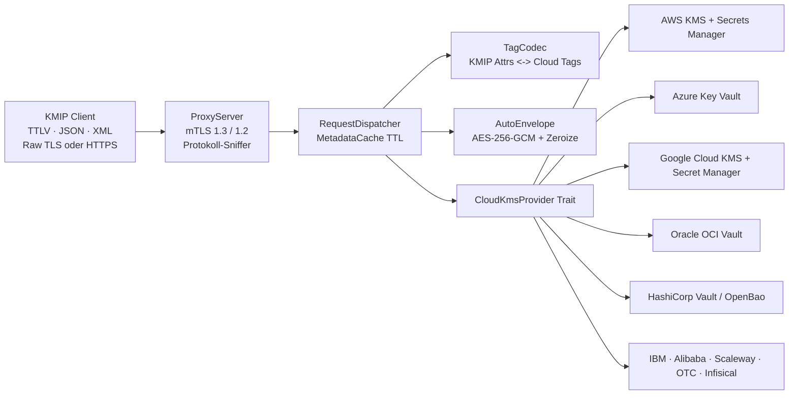

# 05. KMIPKit Cloud KMS Proxy Leitfaden

Unternehmensdatenbanken (MongoDB, MySQL, PostgreSQL, Oracle), Hypervisoren (VMware vSphere, Nutanix) und Speicher-Arrays (NetApp, Dell EMC, Pure Storage, Ceph) verlangen **OASIS KMIP** — öffentliche Cloud-KMS-Dienste bieten jedoch proprietäre REST/gRPC-APIs.

**`kmipkit-proxy`** ist ein **Zero-DB Stateless Sidecar**, der KMIP 2.0, 2.1 und 3.0 (sowie KMIP 1.X über die Legacy-Bridge) direkt in Aufrufe für **10 Cloud- und Enterprise-KMS-Anbieter** übersetzt.

---

## 1. Zentrale Architektursäulen



### Säule 1: Cloud Tag-Stuffing (`tag_codec.rs`)
Cloud-KMS-Dienste speichern nativ keine KMIP-Attribute (`State`, `Cryptographic Usage Mask`, `Activation Date`, `Name`, `Link` usw.). `TagCodec` serialisiert diese deterministisch in normierte Tags/Labels (`kmip_state`, `kmip_usage_mask`, `kmip_name_0` usw.) mit **RFC 4648 Base32Hex** (`<= 60` Zeichen pro Chunk, z. B. für GCPs 63-Zeichen-Limit).

### Säule 2: Auto-Envelope Key Custody (`envelope.rs`)
Viele Legacy-Systeme erwarten, dass `Create` + `Get` rohe AES-256-Schlüsselbytes exportiert. Drei Betriebsmodi (`key_custody_mode`) stehen bereit:

| Modus | Verhalten | Anwendungsfall |
| :--- | :--- | :--- |
| **`native_kms`** | Schlüssel verbleiben im Cloud-HSM. `Encrypt`/`Decrypt`/`Sign`/`Verify` laufen im Cloud-KMS. `Get` liefert nur öffentliche Schlüssel. | Maximale HSM-Compliance. |
| **`auto_envelope`** | Erzeugt einen 256-Bit-DEK im Zeroized RAM, verpackt ihn mit **AES-256-GCM** unter einer Master KEK und speichert den Blob im Secret Store. `Get` entpackt dynamisch. | Datenbanken/Arrays (MongoDB, vSphere, NetApp), die DEK-Export via `Get` verlangen. |
| **`auto`** (Standard) | `auto_envelope` für exportierbare symmetrische Schlüssel; `native_kms` für nicht-exportierbare/asymmetrische HSM-Schlüssel. | Gemischte Enterprise-Workloads. |

---

## 2. Unterstützte Cloud- & Enterprise-Anbieter (10 Backends)

| Anbieter | Cargo Feature | Nativer KMS-Dienst | Secret Store (`AutoEnvelope`) | Wichtige Env-Variablen |
| :--- | :--- | :--- | :--- | :--- |
| **AWS** | `--features aws` | AWS KMS | AWS Secrets Manager | Standard AWS SDK Credential Chain |
| **Azure** | `--features azure` | Azure Key Vault Keys / Managed HSM | Azure Key Vault Secrets | `AZURE_TENANT_ID`, `AZURE_CLIENT_ID`, `AZURE_CLIENT_SECRET` |
| **Google Cloud** | `--features gcp` | Cloud KMS | Cloud Secret Manager | `GOOGLE_OAUTH_ACCESS_TOKEN` |
| **Oracle OCI** | `--features oci` | OCI Vault (Management + Crypto) | OCI Vault Secrets | `OCI_AUTH_TOKEN` |
| **HashiCorp Vault / OpenBao** | `--features vault` | Transit Secrets Engine | KV v2 Secrets Engine | `VAULT_TOKEN` |
| **Infisical** | `--features infisical` | Infisical KMS | Infisical Secrets | `INFISICAL_TOKEN` |
| **IBM Cloud** | `--features ibm` | IBM Key Protect | IBM Key Protect Standard Keys | `IBMCLOUD_API_KEY`, `IBM_AUTH_TOKEN` |
| **Alibaba Cloud** | `--features alibaba` | Alibaba Cloud KMS | Alibaba Secrets Manager | `ALIBABA_CLOUD_ACCESS_KEY_ID`, `ALIBABA_CLOUD_ACCESS_KEY_SECRET`, `ALIBABA_AUTH_TOKEN` |
| **Scaleway** | `--features scaleway` | Scaleway Key Manager | Scaleway Secret Manager | `SCW_SECRET_KEY`, `SCW_DEFAULT_PROJECT_ID` |
| **Open Telekom Cloud** | `--features otc` | OTC KMS (DEW) | OTC CSMS | `OTC_REGION`, `OTC_PROJECT_ID`, `OTC_AUTH_TOKEN` |

Build mit allen Anbietern und gepinntem OpenSSL:
```bash
python3 verification/security/openssl/build.py
export OPENSSL_DIR="$HOME/.cache/kmipkit/openssl/3.5.9"
export OPENSSL_STATIC=1
cargo build --release --manifest-path kmip-proxy/Cargo.toml --features all-clouds
```

> **CLI vs. Library-Instanziierung:** Die `kmipkit-proxy`-CLI (`kmip-proxy/src/main.rs`) initialisiert direkt `kmip-upstream`, `mock`, `aws`, `azure`, `gcp` und `oci`. Für `vault`, `infisical`, `ibm`, `alibaba`, `scaleway` und `otc` nutzen Sie `kmipkit_proxy::providers::create_provider(&config.backend)`.

---

## 3. Protokoll-Sniffing, TLS & Unterstützte KMIP-Operationen

* **Single-Port Sniffing:** Prüft das erste Byte (`0x42` → Raw TTLV; `'P'`/`'p'` → HTTP/1.1 `POST` mit `Content-Type`: `application/octet-stream`, `application/json`, `text/xml`/`application/xml` + Keep-Alive).
* **Sicherheitsgrenzen:** HTTP-Header `<= 16 KiB`, TTLV/HTTP/JSON-Payloads `<= 16 MiB`, JSON-Tiefe `<= 64`, `#![forbid(unsafe_code)]`.
* **PEM/DER-Zertifikate & AutoPKI:** Zertifikate, Keys (`PKCS#8`, RSA, EC) und CAs werden als **PEM oder DER** automatisch erkannt; ohne `tls_cert_path` wird `AutoPki` dynamisch erzeugt.
* **Unterstützte KMIP-Operationen (`RequestDispatcher`):** `Create`, `Create Key Pair`, `Register`, `Locate`, `Get`, `Activate`, `Revoke`, `Destroy`, `Deactivate`, `Get Attributes`, `Get Attribute List`, `Add/Modify/Delete Attribute`, `Encrypt`, `Decrypt`, `Sign`, `Signature Verify`, `MAC`, `MAC Verify`, `RNG Retrieve`, `Query`, `Discover Versions`, `Ping`.

---

## 4. Konfigurationsbeispiele & CLI (`proxy.toml`)

### Beispiel A: AWS KMS + Secrets Manager

```toml
[listener]
bind_addr = "0.0.0.0:5696"
tls_enabled = true
require_client_cert = true
tls_cert_path = "/etc/kmip-proxy/server.crt"
tls_key_path = "/etc/kmip-proxy/server.key"
tls_client_ca_path = "/etc/kmip-proxy/client-ca.crt"

[proxy_behavior]
key_custody_mode = "auto"
metadata_cache_ttl_secs = 5

[backend]
provider = "aws"

[backend.aws]
region = "eu-west-1"
envelope_master_kek_id = "arn:aws:kms:eu-west-1:123456789012:key/mrk-1234abcd"
secret_name_prefix = "kmipkit/"
```

### Beispiel B: HashiCorp Vault / OpenBao (über `create_provider`)

```toml
[listener]
bind_addr = "0.0.0.0:5696"
tls_enabled = true
require_client_cert = true

[backend]
provider = "vault"

[backend.vault]
endpoint_url = "https://vault.internal.example.com:8200"
namespace = "prod-kms"
transit_mount = "transit"
kv_v2_mount = "secret"
item_prefix = "kmipkit/"
allow_transit_export = true
auth_method = "approle"
role_id = "your-approle-id"
role_cred = "your-approle-secret"
```

### Proxy starten & CLI-Flags

```bash
kmipkit-proxy --config /etc/kmip-proxy/proxy.toml
```

CLI-Optionen: `-c/--config`, `-l/--listen`, `-p/--provider`, `--upstream-endpoint`, `--upstream-version`, `--allow-tls12`, `--master-kek-hex`, `--no-client-auth`, `--no-tls`. Vollständige Referenz in [`kmip-proxy/docs/configuration-and-providers.md`](../../kmip-proxy/docs/configuration-and-providers.md).
