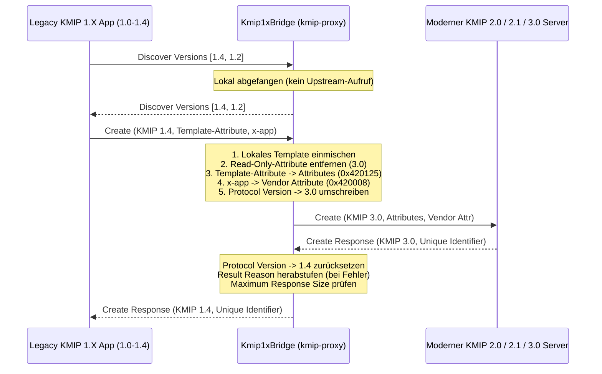

# 06. KMIP 1.X (1.0–1.4) zu KMIP 2.0 / 2.1 / 3.0 Legacy Bridge Leitfaden

Legacy-Unternehmenssoftware (ältere MongoDB/Oracle/MySQL-Versionen, Bandbibliotheken, Storage-Arrays und Bank-Switches) verwendet oft **KMIP 1.0, 1.1, 1.2, 1.3 oder 1.4**, während moderne HSMs und KMS-Server **KMIP 2.0, 2.1 oder 3.0** voraussetzen.

Das Modul **`kmip1x`** in `kmip-proxy` (standardmäßig über `kmip1x-bridge` aktiviert) bietet einen **transparenten, bidirektionalen Protokoll-Übersetzungsproxy**, ohne dass eine einzige Zeile Legacy-Code angepasst werden muss.

---

## 1. Übersetzungsarchitektur (C2S & S2C)



---

## 2. Vollständige Protokoll-Übersetzungsmatrix

| KMIP 1.0–1.4 Konzept | KMIP 2.0 / 2.1 / 3.0 Äquivalent | Bridge-Verhalten (`src/kmip1x/`) |
| :--- | :--- | :--- |
| **`Attribute` (`0x420008`)** `{ Name, Index?, Value }` | **`Attributes` (`0x420125`)** mit direkten Tags | Bidirektionale Übersetzung aller **77 Standardattribute KMIP 1.0–1.4** (inkl. `Key Block` `->` `Key Value`). |
| **`Template-Attribute`** (`Common`/`Private`/`Public`) | **`Attributes`** (`0x420125..=0x420128`) | Automatisch übersetzt; mischt Attribute lokal gespeicherter `Template`-Objekte ein. |
| **`Template` (`0x06`)** | *In KMIP 2.0 entfernt* | Lokal emuliert über threadsicheren `TemplateStore` (im Speicher oder optional atomar auf Disk via `template_store_path`). |
| **`Add Attribute` (`0x0D`)** | `Set Attribute` (`0x31`) oder `Add Attribute` (`0x0D`) | Kardinalitäts-Routing: `SingleInstance` `->` `Set Attribute`; `MultiInstance` `->` `Add Attribute`. Antwort stets als `0x0D`. |
| **`Modify/Delete Attribute` mit `Attribute Index`** | `Current Attribute` (`0x42013C`) + `New Attribute` (`0x42013D`) | Automatisches **Read-Modify-Write**: `Get Attributes` `->` exakte Indexauflösung (Standard, Custom, KMIP-3.0-Links) `->` `Modify`/`Delete`. |
| **Custom `x-*` / `y-*` Attribute** | **Vendor Attribute** (`0x420008` + `Vendor Identification`) | Verlustfreies Mapping (`x-dept` `<->` `{ Vendor: "x", Name: "dept" }`). |
| **KMIP 1.X `Link` (`0x42004A`)** | **KMIP 3.0 Typed Links (`0x420190..=0x42019D`)** | Alle 14 `Link Type`-Werte bidirektional zu KMIP 3.0 abgebildet. |
| **Impliziter `ID Placeholder`** | `Unique Identifier = Enumeration(1)` oder konkrete UID | Automatisch injiziert bei verketteten und orchestrierten Batches. |
| **`Operation Policy Name`** | *In KMIP 2.0 entfernt* | Konfigurierbar: `ignore` (Standard), `store_as_vendor_attribute`, oder `reject`. |
| **`Discover Versions` (`0x1E`)** | Bietet `2.0 / 2.1 / 3.0` | Lokal abgefangen; Schnittmenge mit `[1.4, 1.3, 1.2, 1.1, 1.0]`. |
| **`Query` (`0x18`)** | Enthält 2.0/3.0-Ops & PQC | Gefiltert pro Version (`1.0`..`1.4`); entfernt `Set Attribute`, `ML-KEM`, `ML-DSA`, `Quantum Safe Capability`. |
| **`Result Reason` (`0x17..=0x4D`)** | Erweiterte 2.0/2.1/3.0-Fehlercodes | Auf den nächstgelegenen gültigen KMIP-1.X-Fehlercode herabgestuft. |
| **`Maximum Response Size`** | Auf 2.0+ angewendet | Auf dem serialisierten **KMIP-1.X-TTLV** neu geprüft; liefert bei Überschreitung `Response Too Large (0x02)`. |
| **Pass-Through (`major >= 2`)** | Natives KMIP 2.0 / 2.1 / 3.0 | Direkte Durchleitung ohne Overhead für moderne Clients. |

---

## 3. Konfiguration & Deployment

### TOML-Konfiguration (`kmip1x-bridge.toml`)

```toml
[listener]
bind_addr = "0.0.0.0:5696"
tls_enabled = true
# Aktiviert TLS 1.2 + TLS 1.3 für Legacy-Clients (PEM oder DER auf Disk)
allow_tls12 = true
require_client_cert = true
tls_cert_path = "/etc/kmip-bridge/listener.crt"
tls_key_path = "/etc/kmip-bridge/listener.key"
tls_client_ca_path = "/etc/kmip-bridge/legacy-clients-ca.crt"

[backend]
provider = "kmip-upstream"

[backend.kmip_upstream]
endpoint = "hsm-kms.internal.example.com:5697"
target_version = "3.0"
wire_encoding = "ttlv"
client_cert_path = "/etc/kmip-bridge/upstream-client.crt"
client_key_path = "/etc/kmip-bridge/upstream-client.key"
ca_cert_path = "/etc/kmip-bridge/upstream-ca.crt"
allow_tls12 = false
timeout_secs = 30
operation_policy_mode = "ignore"
max_connections = 8
# Optional: persistente Speicherung von KMIP-1.X-Templates
# template_store_path = "/var/lib/kmip-bridge/templates.json"
```

### Schneller CLI-Start

```bash
kmipkit-proxy --config /etc/kmip-bridge/kmip1x-bridge.toml

# Oder über CLI-Parameter:
kmipkit-proxy \
  --listen 0.0.0.0:5696 \
  --provider kmip-upstream \
  --upstream-endpoint hsm-kms.internal:5697 \
  --upstream-version 3.0 \
  --allow-tls12
```

---

## 4. Programmgesteuerte Einbettung & Cloud-KMS-Verkettung

```rust
use std::sync::Arc;
use kmipkit_proxy::{
    Kmip1xBridge, LocalDispatcherUpstream, ProxyBehaviorConfig, ProxyConfig, ProxyServer,
    RequestDispatcher, UpstreamKmipVersion,
};

let cloud_dispatcher = Arc::new(RequestDispatcher::new(
    cloud_provider,
    ProxyBehaviorConfig::default(),
));
let bridge = Arc::new(Kmip1xBridge::new(
    Arc::new(LocalDispatcherUpstream::new(cloud_dispatcher)),
    UpstreamKmipVersion::V2_1,
));

let handle = ProxyServer::start_kmip1x_bridge(proxy_config, bridge).await?;
```

---

## 5. Server-to-Client (S2C) Bridge (`Kmip1xS2cBridge`)

Für KMIP 2.0/2.1/3.0-Server, die `Notify`, `Put`, `Query` oder `Discover Versions` an Legacy-1.X-Clients initiieren, übersetzt `kmipkit_proxy::Kmip1xS2cBridge` die Anfragen in KMIP 1.X und die Client-Antworten zurück an den Server.
