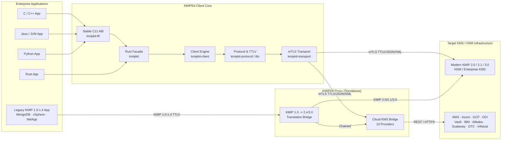

# KMIPKit Documentation Portal (English)

> **Version:** 1.0.0 | **Protocol Support:** OASIS KMIP 2.0, 2.1 (default), 3.0 + Legacy KMIP 1.0–1.4 Bridge  
> **Languages:** Rust · C (C11 ABI) · Java (JNI) · Python (CFFI)  
> **Wire Encodings:** TTLV (default) · JSON · XML | **Transports:** Raw TLS 1.3/1.2 · HTTPS (HTTP/1.1)

**Language / Idioma / Langue:** **English** · [Español](../es/00-index.md) · [Français](../fr/00-index.md)

---

## Executive Overview

**KMIPKit** is a production-grade, memory-safe, open-source **OASIS KMIP** cryptographic infrastructure suite built around a single authoritative Rust core. It eliminates protocol drift across polyglot enterprise environments by exposing a **unified, specification-audited implementation** to Rust, C, Java, and Python applications—paired with a **Zero-DB Stateless Proxy** that bridges both **Cloud KMS APIs** and **legacy KMIP 1.X applications** to modern KMIP 2.0, 2.1, and 3.0 servers.

---

## Documentation Map

| Guide | Audience | What You Will Learn |
| :--- | :--- | :--- |
| **[01. Getting Started & Quickstart](01-getting-started.md)** | Developers, DevOps | Building with pinned OpenSSL, mTLS PKI setup, and complete end-to-end key lifecycle examples in **Rust, C, Java, and Python**. |
| **[02. Architecture & Security Model](02-architecture-and-security.md)** | Security Architects, Auditors | 8-crate Rust workspace, 3 API levels, TLS 1.3/1.2 mTLS policy, zeroization, secret redaction, delivery-state guarantees, and FFI handle isolation. |
| **[03. KMIP 2.0 / 2.1 / 3.0 Protocol & Operations](03-operations-and-protocol-guide.md)** | Cryptography Engineers | Complete reference for all 59 C2S/S2C operations, batch execution, `ID Placeholder`, async `Poll`/`Cancel`/`Process`, Vendor Extensions, and KMIP 3.0 PQC (`ML-KEM`, `ML-DSA`, `SLH-DSA`). |
| **[04. Multi-Language Bindings Reference](04-language-bindings-reference.md)** | Rust / C / Java / Python Teams | Idiomatic patterns, memory ownership, error snapshots, thread safety, Maven/Gradle, CMake, and Python packaging. |
| **[05. Cloud KMS Proxy Guide](05-kmip-proxy-cloud-kms.md)** | Cloud & Platform Engineers | Zero-DB Stateless Sidecar, Cloud Tag-Stuffing codec, Auto-Envelope AES-256-GCM wrapping, and configuration for all 10 cloud/enterprise KMS providers. |
| **[06. KMIP 1.X Legacy Bridge Guide](06-kmip1x-legacy-bridge.md)** | Modernization & IAM Teams | Transparent translation of KMIP 1.0–1.4 apps to KMIP 2.0/2.1/3.0 servers, 77 attributes, `Template` emulation, Read-Modify-Write `Attribute Index`, and S2C bridging. |
| **[07. Enterprise Integrations & Operations](07-enterprise-integrations-and-deployment.md)** | SREs, DBAs, Storage Admins | Ready-to-use playbooks for MongoDB, MySQL, VMware vSphere, NetApp ONTAP, Kubernetes/Docker distroless deployment, and troubleshooting. |

---

## Key Engineering Guarantees

* **Single Source of Truth:** Rust owns all TTLV framing, protocol validation, and transport security. C, Java, and Python bindings never re-implement KMIP parsing or cryptographic logic.
* **Memory Safety & Zeroization:** `#![forbid(unsafe_code)]` across all core crates and `kmip-proxy`. Sensitive key material and credential buffers are explicitly zeroized on drop and redacted from all `Debug`/`Display` logs.
* **No Silent Retries:** Network and protocol failures return structured `RequestDeliveryState` evidence (`NotSent`, `PossiblySent`, `ResponseStarted`) so callers make deterministic idempotency decisions.
* **Zero-DB Stateless Proxy:** Both the Cloud KMS Proxy and the KMIP 1.X Translation Bridge run as lightweight, stateless sidecars with zero external database dependencies.
* **Strict Conformance Discipline:** Normative catalogs are generated directly from pinned OASIS KMIP specifications. KMIPKit explicitly distinguishes implemented API surfaces from formal OASIS profile certification.
