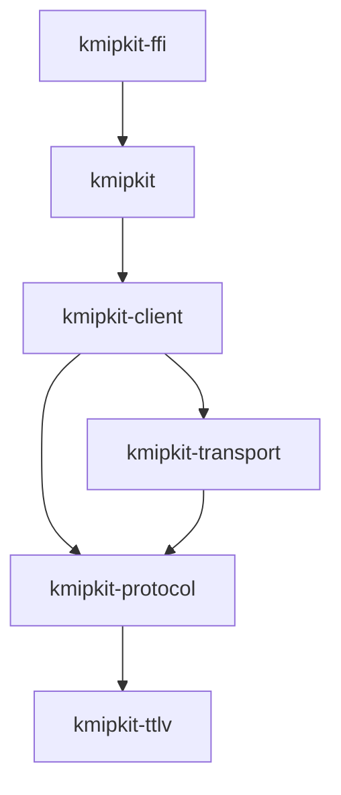

# 02. Architecture & Security Model

KMIPKit is engineered for regulated enterprise environments (banking, payment HSMs, sovereign clouds, and high-assurance key management). Every crate boundary, memory ownership rule, and transport invariant is enforced at compile time and verified by automated security gates.

---

## 1. Layered Workspace Architecture

The repository is split into **two strictly isolated Cargo workspaces**:

```text
KMIPKit/
├── crates/                     # Core Client Workspace (8 crates)
│   ├── kmipkit-ttlv/           # Bounded, ordered generic TTLV model & codec
│   ├── kmipkit-protocol/       # Normative catalog, typed models, schema validation, version gates
│   ├── kmipkit-transport/      # Production Raw TLS & HTTPS/1.1 mTLS adapters, zeroizing buffers
│   ├── kmipkit-client/         # Synchronous execution, batching, async outcomes, S2C listeners
│   ├── kmipkit/                # Public Rust facade & ergonomic Fluent Builders
│   ├── kmipkit-ffi/            # Stable C11 ABI (ONLY crate permitted `unsafe`)
│   ├── kmipkit-test-support/   # Ephemeral PKI, scripted transports, fixtures (unpublished)
│   └── kmipkit-test-server/    # Multi-version standalone KMIP test server
├── bindings/                   # Native Language Adapters
│   ├── c/                      # C11 headers, CMake, ABI consumer tests
│   ├── java/                   # JNI C++ bridge + idiomatic Java 17 API
│   └── python/                 # CFFI bridge + typed Python 3.10+ API
└── kmip-proxy/                 # Independent Standalone Proxy Workspace
    ├── src/providers/          # 10 Cloud / Enterprise KMS bridges
    └── src/kmip1x/             # KMIP 1.0-1.4 <-> KMIP 2.0/2.1/3.0 Translation Bridge
```

### Strict Dependency Direction



* `kmipkit-proxy` has its own `Cargo.toml` and `Cargo.lock`, ensuring cloud SDK dependencies (`aws-sdk-kms`, `azure_security_keyvault_*`, `reqwest`, etc.) **never leak** into the core KMIPKit client library or its C/Java/Python packages.

---

## 2. Three Supported API Levels

KMIPKit exposes three complementary API tiers—inspectable at runtime via `kmipkit::api_levels()` (Rust), `kmipkit_api_levels_get_v1` (C), `RuntimeMetadata.apiLevels()` (Java), and `kmipkit.metadata.get_api_levels()` (Python):

| API Tier | Purpose | Best For |
| :--- | :--- | :--- |
| **1. High-Level Fluent** | Task-oriented builders (`create_symmetric_key()`, `encrypt()`, `activate()`, `revoke()`) | 90% of enterprise application integrations. |
| **2. Typed Protocol** | Explicit `ClientBatch`, `ClientBatchItem`, `ClientRequest` (all 59 operations), `RequestOptions`, preflight `validation_report()` | Multi-operation atomic batches, custom `ID Placeholder` chaining, async `Poll`/`Cancel`/`Process`. |
| **3. Generic TTLV** | Ordered `Item` / `Structure` / `Value` tree (`kmipkit-ttlv`) | Inspecting unknown vendor tags, preserving wire order, building custom extensions or proxies. |

---

## 3. Transport & Cryptographic Security Invariants

### TLS Policy (`kmipkit-transport`)

| Security Control | Default Production Policy | Opt-In Compatibility |
| :--- | :--- | :--- |
| **TLS Version** | **TLS 1.3 Only** (`TlsVersionPolicy::Tls13Only`) | `Tls12And13Compat` (restricted strictly to OASIS KMIP Profiles ECDHE-GCM suites) |
| **Cipher Suites (TLS 1.3)** | `TLS13_AES_256_GCM_SHA384`, `TLS13_CHACHA20_POLY1305_SHA256` | — |
| **Post-Quantum Certs** | **ML-DSA-44 / ML-DSA-65 / ML-DSA-87** via OpenSSL 3.5 | — |
| **Authentication** | **Mandatory Mutual TLS (mTLS)** | — |
| **Certificate Verification** | Chain + Validity + Hostname/SAN + optional local CRLs | No network OCSP/CRL fetches; no "insecure skip verify" flag |
| **0-RTT / Early Data** | **Disabled** (prevents replay of KMIP mutations) | Cannot be enabled |
| **TLS Key Logging** | **Disabled** (`SSLKEYLOGFILE` ignored) | Cannot be enabled |
| **Session Resumption** | Bounded in-memory store (max 16 tickets, 1-hour expiry) | Scoped per client config; never persisted to disk |
| **HTTP/1.1 Hardening** | Direct `POST /kmip`, single `Host`, no redirects, no proxies, no compression | — |

### Memory Ownership, Zeroization & Redaction

1. **Zeroization on Drop:** Private keys, passwords, secret bytes, temporary request buffers, and `TransportResponse` allocations use `zeroize::Zeroizing` / explicit `Drop` clearing.
2. **Total Diagnostic Redaction:** Every `Debug` and `Display` implementation for credentials, endpoints, TLS errors, and TTLV payloads outputs `[REDACTED]` or safe category enums—never raw keys, passwords, hostnames, or OS error strings.
3. **Bounded Decoding (`CodecLimits`):** TTLV, JSON, and XML decoders enforce strict maximum message bytes (default 16 MiB), maximum nesting depth (64), and maximum element counts **before** allocating memory.
4. **No `unsafe` Outside FFI:** `#![forbid(unsafe_code)]` is enforced on every crate except `kmipkit-ffi`.

---

## 4. Delivery-State Guarantees (Zero Automatic Retries)

Cryptographic operations (`Create`, `Re-key`, `Revoke`, `Destroy`) are **not blindly idempotent**. KMIPKit **never** retries failed requests automatically. Instead, every transport or protocol error carries a deterministic `RequestDeliveryState`:

| `RequestDeliveryState` | Exact Meaning | Safe Caller Action |
| :--- | :--- | :--- |
| **`NotSent`** | Failed locally (validation, DNS, TLS handshake, preflight limit) before any request byte hit the wire. | Safe to fix input or retry immediately. |
| **`PossiblySent`** | At least one request byte was handed to the TLS writer, but no response byte arrived before timeout/reset. | Ambiguous state: query/locate on server before retrying non-idempotent operations. |
| **`ResponseStarted`** | At least one response byte arrived from the server, then framing/truncation/timeout failed. | Server processed the request; reconcile state before retrying. |

---

## 5. C ABI Handle Isolation & Panic Containment

To protect C, Java, and Python hosts from use-after-free, double-free, and Rust unwinding:

* **Opaque Permuted Handles:** Exported pointers are process-local tokens generated via an **8-round Feistel permutation driven by a per-process random HMAC-SHA-256 key**, backed by a live-handle table. Forged or stale pointers are rejected safely.
* **Zero Unwinding Across FFI:** Every `extern "C"` function wraps its body in `std::panic::catch_unwind`, mapping any unexpected panic to `KMIPKIT_ERROR_INTERNAL (7)` without leaking panic payloads.
* **Thread-Local Error Snapshots:** Callers inspect structured failure metadata (`category`, `cause`, `delivery_state`) via `kmipkit_last_error_get()`.
