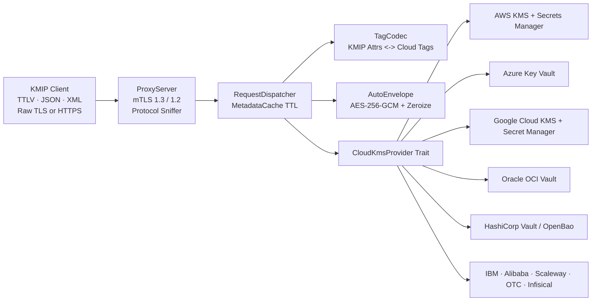

# 05. KMIPKit Cloud KMS Proxy Guide

Enterprise databases (MongoDB, MySQL, PostgreSQL, Oracle), hypervisors (VMware vSphere, Nutanix), and storage arrays (NetApp, Dell EMC, Pure Storage, Ceph) require **OASIS KMIP**—yet public cloud KMS services expose proprietary REST/gRPC APIs.

**`kmipkit-proxy`** is a **Zero-DB Stateless Sidecar** that translates KMIP 2.0, 2.1, and 3.0 (and KMIP 1.X when chained with the KMIP 1.X Bridge) into native calls against **10 cloud and enterprise KMS providers** without requiring any local database.

---

## 1. Core Architectural Pillars



### Pillar 1: Cloud Tag-Stuffing (`tag_codec.rs`)
Cloud KMS services do not natively store KMIP attributes (`State`, `Cryptographic Usage Mask`, `Activation Date`, `Protect Stop Date`, `Deactivation Date`, `Revocation Reason`, `Name`, `Link`). `TagCodec` deterministically serializes these into normalized, lowercase cloud tags/labels (`kmip_state`, `kmip_usage_mask`, `kmip_name_0`, etc.), using **RFC 4648 Base32Hex** chunked at `<= 60` characters to satisfy strict provider limits (such as GCP's 63-character label restriction).

### Pillar 2: Auto-Envelope Key Custody (`envelope.rs`)
Many legacy KMIP applications expect `Create` + `Get` to export raw AES-256 key bytes, whereas cloud KMS HSMs forbid exporting symmetric master keys. `kmipkit-proxy` supports three custody modes (`key_custody_mode`):

| Mode | Behavior | When to Use |
| :--- | :--- | :--- |
| **`native_kms`** | Keys stay strictly inside the cloud HSM. `Encrypt`/`Decrypt`/`Sign`/`Verify` execute remotely in the cloud KMS. `Get` returns public keys only. | Maximum HSM compliance; apps delegating crypto operations. |
| **`auto_envelope`** | Generates a random 256-bit DEK in zeroized RAM, wraps it with **AES-256-GCM** using a cloud Master KEK, and stores the encrypted blob in the provider's native Secret Store. `Get` unwraps on the fly. | Databases/storage arrays (MongoDB, vSphere, NetApp) that require exporting raw symmetric DEKs via KMIP `Get`. |
| **`auto`** (default) | Uses `auto_envelope` for exportable symmetric keys and `native_kms` for non-exportable/asymmetric HSM keys. | Mixed enterprise workloads. |

---

## 2. Supported Cloud & Enterprise Providers (10 Backends)

| Provider | Cargo Feature | Native KMS Service | Secret Store (`AutoEnvelope`) | Primary Env Credentials |
| :--- | :--- | :--- | :--- | :--- |
| **AWS** | `--features aws` | AWS KMS | AWS Secrets Manager | Standard AWS SDK chain |
| **Azure** | `--features azure` | Azure Key Vault Keys / Managed HSM | Azure Key Vault Secrets | `AZURE_TENANT_ID`, `AZURE_CLIENT_ID`, `AZURE_CLIENT_SECRET` |
| **Google Cloud** | `--features gcp` | Cloud KMS | Cloud Secret Manager | `GOOGLE_OAUTH_ACCESS_TOKEN` |
| **Oracle OCI** | `--features oci` | OCI Vault (Management + Crypto) | OCI Vault Secrets | `OCI_AUTH_TOKEN` |
| **HashiCorp Vault / OpenBao** | `--features vault` | Transit Secrets Engine | KV v2 Secrets Engine | `VAULT_TOKEN` |
| **Infisical** | `--features infisical` | Infisical KMS | Infisical Secrets | `INFISICAL_TOKEN` |
| **IBM Cloud** | `--features ibm` | IBM Key Protect | IBM Key Protect Standard Keys | `IBMCLOUD_API_KEY`, `IBM_AUTH_TOKEN` |
| **Alibaba Cloud** | `--features alibaba` | Alibaba Cloud KMS | Alibaba Secrets Manager | `ALIBABA_CLOUD_ACCESS_KEY_ID`, `ALIBABA_CLOUD_ACCESS_KEY_SECRET`, `ALIBABA_AUTH_TOKEN` |
| **Scaleway** | `--features scaleway` | Scaleway Key Manager | Scaleway Secret Manager | `SCW_SECRET_KEY`, `SCW_DEFAULT_PROJECT_ID` |
| **Open Telekom Cloud** | `--features otc` | OTC KMS (DEW) | OTC CSMS | `OTC_REGION`, `OTC_PROJECT_ID`, `OTC_AUTH_TOKEN` |

Build with all providers enabled (using the repository's pinned OpenSSL build):
```bash
python3 verification/security/openssl/build.py
export OPENSSL_DIR="$HOME/.cache/kmipkit/openssl/3.5.9"
export OPENSSL_STATIC=1
cargo build --release --manifest-path kmip-proxy/Cargo.toml --features all-clouds
```

> **CLI vs Library Instantiation:** The standalone `kmipkit-proxy` CLI binary (`kmip-proxy/src/main.rs`) directly instantiates `kmip-upstream`, `mock`, `aws`, `azure`, `gcp`, and `oci`. To run `vault`, `infisical`, `ibm`, `alibaba`, `scaleway`, or `otc`, instantiate them through `kmipkit_proxy::providers::create_provider(&config.backend)` in your Rust service.

---

## 3. Wire Protocol Sniffing, TLS & Supported KMIP Operations

* **Single-port Protocol Sniffing:** Reads the first socket byte (`0x42` → Raw TTLV; `'P'`/`'p'` → HTTP/1.1 `POST` routing `application/octet-stream`, `application/json`, or `text/xml`/`application/xml` with keep-alive).
* **Size & Safety Guards:** Caps HTTP headers at `16 KiB`, TTLV/HTTP/JSON payloads at `16 MiB`, and JSON recursion at depth `64`; enforces `#![forbid(unsafe_code)]`.
* **Certificate Loading & AutoPKI:** Accepts **both PEM and DER** certificates, private keys (`PKCS#8`, RSA, EC), and CAs. If `tls_enabled = true` and `tls_cert_path` is omitted, `ProxyServer` generates an ephemeral in-memory `AutoPki` CA/server/client hierarchy.
* **Supported Operations (`RequestDispatcher`):** `Create`, `Create Key Pair`, `Register`, `Locate`, `Get`, `Activate`, `Revoke`, `Destroy`, `Deactivate`, `Get Attributes`, `Get Attribute List`, `Add/Modify/Delete Attribute`, `Encrypt`, `Decrypt`, `Sign`, `Signature Verify`, `MAC`, `MAC Verify`, `RNG Retrieve`, `Query`, `Discover Versions`, `Ping`.

---

## 4. Configuration Examples & CLI Reference (`proxy.toml`)

### Example A: AWS KMS + Secrets Manager

```toml
[listener]
bind_addr = "0.0.0.0:5696"
tls_enabled = true
require_client_cert = true
tls_cert_path = "/etc/kmip-proxy/server.crt"
tls_key_path = "/etc/kmip-proxy/server.key"
tls_client_ca_path = "/etc/kmip-proxy/client-ca.crt"

[proxy_behavior]
key_custody_mode = "auto"
metadata_cache_ttl_secs = 5

[backend]
provider = "aws"

[backend.aws]
region = "eu-west-1"
envelope_master_kek_id = "arn:aws:kms:eu-west-1:123456789012:key/mrk-1234abcd"
secret_name_prefix = "kmipkit/"
```

### Example B: HashiCorp Vault / OpenBao (via `create_provider`)

```toml
[listener]
bind_addr = "0.0.0.0:5696"
tls_enabled = true
require_client_cert = true

[backend]
provider = "vault"

[backend.vault]
endpoint_url = "https://vault.internal.example.com:8200"
namespace = "prod-kms"
transit_mount = "transit"
kv_v2_mount = "secret"
item_prefix = "kmipkit/"
allow_transit_export = true
auth_method = "approle"
role_id = "your-approle-id"
role_cred = "your-approle-secret"
```

### Running & CLI Flags

```bash
kmipkit-proxy --config /etc/kmip-proxy/proxy.toml
```

Key CLI flags: `-c/--config`, `-l/--listen`, `-p/--provider`, `--upstream-endpoint`, `--upstream-version`, `--allow-tls12`, `--master-kek-hex`, `--no-client-auth`, `--no-tls`. For the full reference across all 10 providers, see [`kmip-proxy/docs/configuration-and-providers.md`](../../kmip-proxy/docs/configuration-and-providers.md).
