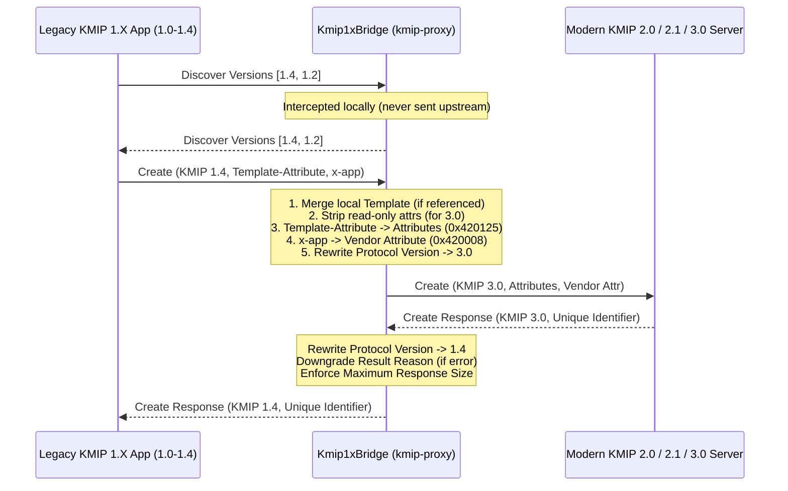

# 06. KMIP 1.X (1.0–1.4) -> KMIP 2.0 / 2.1 / 3.0 Legacy Bridge Guide

Legacy enterprise software (older MongoDB/Oracle/MySQL versions, tape libraries, storage arrays, and banking switches) frequently speaks **KMIP 1.0, 1.1, 1.2, 1.3, or 1.4**, whereas modern HSMs and KMS servers require **KMIP 2.0, 2.1, or 3.0**.

The **`kmip1x`** module inside `kmip-proxy` (enabled by default via feature `kmip1x-bridge`) provides a **transparent, bidirectional protocol translation proxy** so legacy applications can communicate with modern KMIP 2.0/2.1/3.0 servers **without modifying a single line of legacy code**.

---

## 1. Translation Architecture (C2S & S2C)



---

## 2. Complete Protocol Translation Matrix

### Structural & Paradigm Conversions

| KMIP 1.0–1.4 Concept | KMIP 2.0 / 2.1 / 3.0 Equivalent | Bridge Behavior (`src/kmip1x/`) |
| :--- | :--- | :--- |
| **`Attribute` (`0x420008`)** `{ Name, Index?, Value }` | **`Attributes` (`0x420125`)** with direct tags | Bidirectional conversion across **all 77 standard KMIP 1.0–1.4 attributes** (including recursive `Key Block` -> `Key Value` attributes). |
| **`Template-Attribute`** (`Common`/`Private`/`Public`) | **`Attributes`** (`Common`/`Private`/`Public` `0x420125..=0x420128`) | Translated automatically; merges attributes from locally stored `Template` objects. |
| **`Template` Object (`0x06`)** | *Removed in KMIP 2.0* | Emulated locally via thread-safe `TemplateStore` (in-memory or optional atomic JSON persistence via `template_store_path`): `Register`, `Locate`, `Get`, `GetAttributes`, `GetAttributeList`, `Destroy`. |
| **`Add Attribute` (`0x0D`)** | `Set Attribute` (`0x31`) or `Add Attribute` (`0x0D`) | Routed by cardinality: `SingleInstance` -> `Set Attribute`; `MultiInstance` -> `Add Attribute`. Response always restored to `0x0D`. |
| **`Modify Attribute` / `Delete Attribute` with `Attribute Index`** | `Current Attribute` (`0x42013C`) + `New Attribute` (`0x42013D`) | Automatic **Read-Modify-Write**: `Get Attributes` -> resolve exact index (standard, vendor `(vendor, name)`, or KMIP 3.0 typed links) -> `Modify`/`Delete` by value; index preserved in 1.X response. |
| **Custom `x-*` / `y-*` Attributes** | **Vendor Attribute** (`0x420008` + `Vendor Identification`) | Lossless bidirectional mapping (`x-dept` <-> `{ Vendor: "x", Name: "dept" }`). |
| **KMIP 1.X `Link` (`0x42004A`)** | **KMIP 3.0 Typed Links (`0x420190..=0x42019D`)** | All 14 `Link Type` enums map bidirectionally when targeting KMIP 3.0. |
| **Implicit `ID Placeholder`** (omitted UID in batch) | `Unique Identifier = Enumeration(1)` | Automatically injected into chained batch items when omitted in 1.X. |
| **`Key Wrapping Specification` (`0x420047`)** | Uses `Attribute Reference` (`0x42013B`) | Internal 1.X `Attribute Name` items translated to `Attribute Reference` in `Get` and `Export`. |
| **`Operation Policy Name`** | *Removed in KMIP 2.0* | Configurable: `ignore` (default), `store_as_vendor_attribute`, or `reject`. |
| **`Discover Versions` (`0x1E`)** | Advertises `2.0 / 2.1 / 3.0` | Intercepted locally; returns intersection with `[1.4, 1.3, 1.2, 1.1, 1.0]`. |
| **`Query` (`0x18`)** | Includes 2.0/3.0 ops & PQC algorithms | Filtered through version-specific allowlists (`1.0`..`1.4`), stripping `Set Attribute`, `Encapsulate`/`Decapsulate`, `ML-KEM`, `ML-DSA`, `Quantum Safe Capability`. |
| **`Result Reason` (`0x17..=0x4D`)** | Extended 2.0 / 2.1 / 3.0 error codes | Downgraded to the closest valid KMIP 1.X `Result Reason` for the client's exact minor version. |
| **`Maximum Response Size`** | Applied to 2.0+ payload | Re-enforced on the final serialized **KMIP 1.X TTLV** byte length; returns `Response Too Large (0x02)` if exceeded. |
| **Pass-Through (`major >= 2`)** | Native KMIP 2.0 / 2.1 / 3.0 | Zero-overhead pass-through for modern clients sharing the same endpoint. |

---

## 3. Configuration & Deployment

### TOML Configuration (`kmip1x-bridge.toml`)

```toml
[listener]
bind_addr = "0.0.0.0:5696"
tls_enabled = true
# Enable TLS 1.2 + TLS 1.3 for legacy KMIP 1.X clients that lack TLS 1.3 support
allow_tls12 = true
require_client_cert = true
tls_cert_path = "/etc/kmip-bridge/listener.crt"
tls_key_path = "/etc/kmip-bridge/listener.key"
tls_client_ca_path = "/etc/kmip-bridge/legacy-clients-ca.crt"

[backend]
provider = "kmip-upstream"

[backend.kmip_upstream]
# Raw TLS ("host:port") or HTTPS ("https://host:port/kmip")
endpoint = "hsm-kms.internal.example.com:5697"
# Target upstream KMIP edition: "2.0", "2.1", or "3.0"
target_version = "3.0"
# Wire encoding toward upstream: "ttlv", "json", or "xml"
wire_encoding = "ttlv"
client_cert_path = "/etc/kmip-bridge/upstream-client.crt"
client_key_path = "/etc/kmip-bridge/upstream-client.key"
ca_cert_path = "/etc/kmip-bridge/upstream-ca.crt"
allow_tls12 = false
timeout_secs = 30
# Policy for removed Operation Policy Name: "ignore" | "store_as_vendor_attribute" | "reject"
operation_policy_mode = "ignore"
max_connections = 8
# Optional: persist KMIP 1.X Template objects atomically across restarts
# template_store_path = "/var/lib/kmip-bridge/templates.json"
```

Note: both listener and upstream certificates, keys, and CA chains auto-detect **PEM and DER** formats.

### Quick CLI Launch

```bash
kmipkit-proxy \
  --config /etc/kmip-bridge/kmip1x-bridge.toml

# Or override flags directly:
kmipkit-proxy \
  --listen 0.0.0.0:5696 \
  --provider kmip-upstream \
  --upstream-endpoint hsm-kms.internal:5697 \
  --upstream-version 3.0 \
  --allow-tls12
```

---

## 4. Programmatic Embedding & Chaining with Cloud KMS

You can chain **`Kmip1xBridge`** directly in front of the **Cloud KMS Proxy** via `LocalDispatcherUpstream`, enabling a **legacy KMIP 1.2/1.4 application** to store keys natively in **AWS KMS, Azure Key Vault, GCP KMS, OCI Vault, or HashiCorp Vault**:

```rust
use std::sync::Arc;
use kmipkit_proxy::{
    Kmip1xBridge, LocalDispatcherUpstream, ProxyBehaviorConfig, ProxyConfig, ProxyServer,
    RequestDispatcher, UpstreamKmipVersion,
};

let cloud_dispatcher = Arc::new(RequestDispatcher::new(
    cloud_provider,
    ProxyBehaviorConfig::default(),
));
let bridge = Arc::new(Kmip1xBridge::new(
    Arc::new(LocalDispatcherUpstream::new(cloud_dispatcher)),
    UpstreamKmipVersion::V2_1,
));

let handle = ProxyServer::start_kmip1x_bridge(proxy_config, bridge).await?;
```

---

## 5. Server-to-Client (S2C) Bridging (`Kmip1xS2cBridge`)

For environments where a KMIP 2.0/2.1/3.0 server initiates `Notify`, `Put`, `Query`, or `Discover Versions` toward a legacy KMIP 1.X client, use `Kmip1xS2cBridge`:
* Intercepts S2C `Discover Versions` locally so the modern server negotiates its expected 2.0/2.1/3.0 version.
* Translates incoming 2.0/2.1/3.0 `Notify` and `Put` `Attributes` structures into KMIP 1.X `Attribute` lists.
* Translates the legacy client's KMIP 1.X `ResponseMessage` back to the server's KMIP 2.0/2.1/3.0 version.

For full implementation details and troubleshooting, see [`kmip-proxy/docs/kmip1x-bridge-reference.md`](../../kmip-proxy/docs/kmip1x-bridge-reference.md) and [`kmip-proxy/docs/testing-and-troubleshooting.md`](../../kmip-proxy/docs/testing-and-troubleshooting.md).
