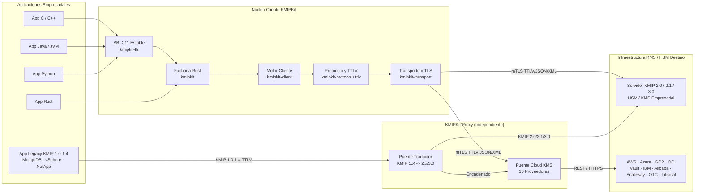

# Portal de Documentación de KMIPKit (Español)

> **Versión:** 1.0.0 | **Soporte de Protocolo:** OASIS KMIP 2.0, 2.1 (por defecto), 3.0 + Puente Legacy KMIP 1.0–1.4  
> **Lenguajes:** Rust · C (ABI C11) · Java (JNI) · Python (CFFI)  
> **Codificaciones:** TTLV (por defecto) · JSON · XML | **Transportes:** Raw TLS 1.3/1.2 · HTTPS (HTTP/1.1)

**Idioma / Language / Langue:** [English](../en/00-index.md) · **Español** · [Français](../fr/00-index.md)

---

## Visión Ejecutiva

**KMIPKit** es una suite criptográfica open-source, segura en memoria y lista para producción para **OASIS KMIP**, construida alrededor de un único núcleo autoritativo en Rust. Elimina la deriva de protocolo en entornos empresariales políglotas exponiendo una **implementación unificada y auditada contra la especificación** para aplicaciones en Rust, C, Java y Python —junto con un **Proxy Stateless sin Base de Datos (Zero-DB)** que conecta tanto **APIs de Cloud KMS** como **aplicaciones legacy KMIP 1.X** con servidores modernos KMIP 2.0, 2.1 y 3.0.

---

## Mapa de Documentación

| Guía | Audiencia | Qué aprenderás |
| :--- | :--- | :--- |
| **[01. Inicio Rápido y Primeros Pasos](01-getting-started.md)** | Desarrolladores, DevOps | Compilación con OpenSSL fijado, configuración PKI mTLS y ejemplos completos de ciclo de vida en **Rust, C, Java y Python**. |
| **[02. Arquitectura y Modelo de Seguridad](02-architecture-and-security.md)** | Arquitectos de Seguridad, Auditores | Workspace de 8 crates, 3 niveles de API, política mTLS TLS 1.3/1.2, zeroización, redacción de secretos, garantías de estado de entrega y aislamiento de handles FFI. |
| **[03. Guía de Protocolo y Operaciones KMIP 2.0 / 2.1 / 3.0](03-operations-and-protocol-guide.md)** | Ingenieros de Criptografía | Referencia completa de las 59 operaciones C2S/S2C, ejecución en lotes, `ID Placeholder`, operaciones asíncronas (`Poll`/`Cancel`/`Process`), extensiones de fabricante y PQC KMIP 3.0 (`ML-KEM`, `ML-DSA`, `SLH-DSA`). |
| **[04. Referencia de Bindings Multi-Lenguaje](04-language-bindings-reference.md)** | Equipos Rust / C / Java / Python | Patrones idiomáticos, propiedad de memoria, snapshots de error, seguridad de hilos, Maven/Gradle, CMake y empaquetado Python. |
| **[05. Guía del Proxy Cloud KMS](05-kmip-proxy-cloud-kms.md)** | Ingenieros Cloud y Plataforma | Sidecar Stateless Zero-DB, códec *Cloud Tag-Stuffing*, cifrado *Auto-Envelope* AES-256-GCM y configuración para los 10 proveedores cloud/empresariales. |
| **[06. Guía del Puente Legacy KMIP 1.X](06-kmip1x-legacy-bridge.md)** | Equipos de Modernización e IAM | Traducción transparente de apps KMIP 1.0–1.4 a servidores KMIP 2.0/2.1/3.0, 77 atributos, emulación de `Template`, *Read-Modify-Write* para `Attribute Index` y puente S2C. |
| **[07. Integraciones Empresariales y Despliegue](07-enterprise-integrations-and-deployment.md)** | SREs, DBAs, Administradores de Almacenamiento | Playbooks listos para producción: MongoDB, MySQL, VMware vSphere, NetApp ONTAP, despliegue Kubernetes/Docker distroless y resolución de problemas. |

---

## Garantías Clave de Ingeniería

* **Fuente Única de Verdad:** Rust controla todo el framing TTLV, la validación de protocolo y la seguridad del transporte. Los bindings de C, Java y Python nunca reimplementan el parseo KMIP ni la lógica criptográfica.
* **Seguridad de Memoria y Zeroización:** `#![forbid(unsafe_code)]` en todos los crates del núcleo y en `kmip-proxy`. Todo material de clave y credencial se zeroiza explícitamente al liberarse y se redacta en los logs `Debug`/`Display`.
* **Sin Reintentos Silenciosos:** Los fallos de red o protocolo devuelven evidencia determinista `RequestDeliveryState` (`NotSent`, `PossiblySent`, `ResponseStarted`) para que la aplicación decida sobre la idempotencia.
* **Proxy Stateless Zero-DB:** Tanto el Proxy Cloud KMS como el Puente KMIP 1.X operan como sidecars ligeros sin dependencias de base de datos externa.
* **Disciplina Normativa Estricta:** Los catálogos normativos se generan desde especificaciones OASIS KMIP fijadas. KMIPKit distingue explícitamente las superficies de API implementadas de la certificación formal de perfiles OASIS.
