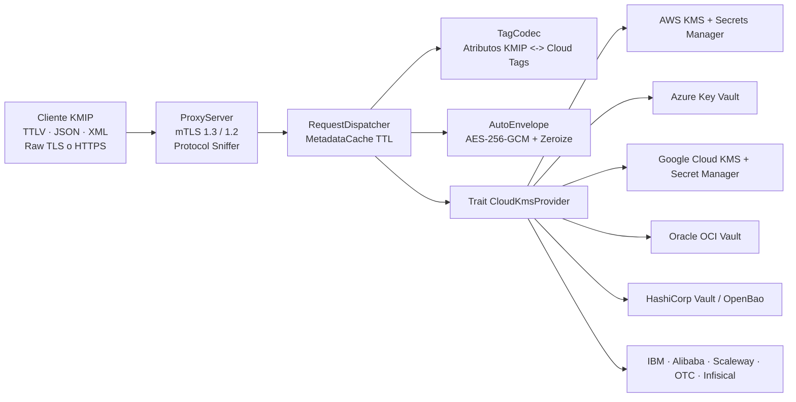

# 05. Guía del Proxy Cloud KMS (`kmipkit-proxy`)

Las bases de datos empresariales (MongoDB, MySQL, PostgreSQL, Oracle), hipervisores (VMware vSphere, Nutanix) y cabinas de almacenamiento (NetApp, Dell EMC, Pure Storage, Ceph) exigen **OASIS KMIP**, mientras que los KMS de nube pública exponen APIs REST/gRPC propietarias.

**`kmipkit-proxy`** es un **Sidecar Stateless sin Base de Datos (Zero-DB)** que traduce KMIP 2.0, 2.1 y 3.0 (y KMIP 1.X encadenado con el puente 1.X) a llamadas nativas contra **10 proveedores Cloud y Enterprise KMS**.

---

## 1. Pilares de Arquitectura



### Pilar 1: Cloud Tag-Stuffing (`tag_codec.rs`)
Serializa determinísticamente los atributos normativos de KMIP (`State`, `Cryptographic Usage Mask`, fechas, `Revocation Reason`, `Name`, `Link`) en etiquetas/labels nativas en minúsculas (`kmip_state`, `kmip_usage_mask`, `kmip_name_0`...) usando **RFC 4648 Base32Hex** fragmentado a `<= 60` caracteres para cumplir límites estrictos (como el límite de 63 caracteres de GCP).

### Pilar 2: Custodia Auto-Envelope (`envelope.rs`)

| Modo | Comportamiento | Cuándo usarlo |
| :--- | :--- | :--- |
| **`native_kms`** | Las claves permanecen estrictamente en el HSM cloud. `Encrypt`/`Decrypt`/`Sign`/`Verify` se ejecutan en remoto. `Get` solo devuelve claves públicas. | Máximo cumplimiento HSM; apps que delegan operaciones criptográficas. |
| **`auto_envelope`** | Genera una DEK aleatoria de 256 bits en RAM zeroizada, la envuelve con **AES-256-GCM** usando la Master KEK cloud y almacena el blob en el Secret Store nativo. `Get` desenvuelve al vuelo. | Bases de datos/almacenamiento (MongoDB, vSphere, NetApp) que exigen exportar bytes simétricos vía KMIP `Get`. |
| **`auto`** (defecto) | Usa `auto_envelope` para claves simétricas exportables y `native_kms` para claves HSM no exportables/asimétricas. | Cargas empresariales mixtas. |

---

## 2. Proveedores Soportados (10 Backends)

| Proveedor | Feature Cargo | Servicio KMS Nativo | Secret Store (Auto-Envelope) |
| :--- | :--- | :--- | :--- |
| **AWS** | `--features aws` | AWS KMS | AWS Secrets Manager |
| **Azure** | `--features azure` | Azure Key Vault Keys / Managed HSM | Azure Key Vault Secrets |
| **Google Cloud** | `--features gcp` | Cloud KMS | Cloud Secret Manager |
| **Oracle OCI** | `--features oci` | OCI Vault (Management + Crypto) | OCI Vault Secrets |
| **HashiCorp Vault / OpenBao** | `--features vault` | Transit Secrets Engine | KV v2 Secrets Engine |
| **Infisical** | `--features infisical` | Infisical KMS | Infisical Secrets |
| **IBM Cloud** | `--features ibm` | IBM Key Protect | IBM Key Protect Standard Keys |
| **Alibaba Cloud** | `--features alibaba` | Alibaba Cloud KMS | Alibaba Secrets Manager |
| **Scaleway** | `--features scaleway` | Scaleway Key Manager | Scaleway Secret Manager |
| **Open Telekom Cloud** | `--features otc` | OTC KMS (DEW) | OTC CSMS |

```bash
cargo build --release --manifest-path kmip-proxy/Cargo.toml --features all-clouds
```

---

## 3. Ejemplos de Configuración (`proxy.toml`)

### Ejemplo A: AWS KMS + Secrets Manager

```toml
[listener]
bind_addr = "0.0.0.0:5696"
tls_enabled = true
require_client_cert = true
tls_cert_path = "/etc/kmip-proxy/server.crt"
tls_key_path = "/etc/kmip-proxy/server.key"
tls_client_ca_path = "/etc/kmip-proxy/client-ca.crt"

[proxy_behavior]
key_custody_mode = "auto"
metadata_cache_ttl_secs = 5

[backend]
provider = "aws"

[backend.aws]
region = "eu-west-1"
envelope_master_kek_id = "arn:aws:kms:eu-west-1:123456789012:key/mrk-1234abcd"
secret_name_prefix = "kmipkit/"
```

### Ejemplo B: HashiCorp Vault / OpenBao

```toml
[listener]
bind_addr = "0.0.0.0:5696"
tls_enabled = true
require_client_cert = true

[backend]
provider = "vault"

[backend.vault]
endpoint_url = "https://vault.internal.example.com:8200"
namespace = "prod-kms"
transit_mount = "transit"
kv_v2_mount = "secret"
item_prefix = "kmipkit/"
allow_transit_export = true
auth_method = "approle"
role_id = "your-approle-id"
role_cred = "your-approle-secret"
```

```bash
kmipkit-proxy --config /etc/kmip-proxy/proxy.toml
```
