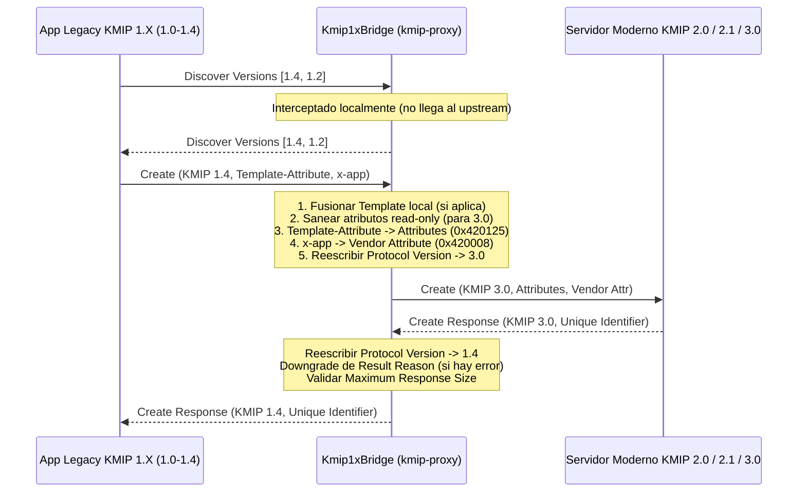

# 06. Guía del Puente Legacy KMIP 1.X (1.0–1.4) -> KMIP 2.0 / 2.1 / 3.0

El software empresarial legacy (versiones antiguas de MongoDB/Oracle/MySQL, librerías de cintas, cabinas de almacenamiento y switches bancarios) suele hablar **KMIP 1.0, 1.1, 1.2, 1.3 o 1.4**, mientras que los HSM y servidores KMS modernos exigen **KMIP 2.0, 2.1 o 3.0**.

El módulo **`kmip1x`** dentro de `kmip-proxy` (activo por defecto mediante la feature `kmip1x-bridge`) proporciona un **proxy traductor bidireccional transparente** para conectar aplicaciones legacy con servidores KMIP 2.0/2.1/3.0 **sin modificar una sola línea de código legacy**.

---

## 1. Arquitectura de Traducción (C2S y S2C)



---

## 2. Matriz Completa de Traducción de Protocolo

| Concepto KMIP 1.0–1.4 | Equivalente KMIP 2.0 / 2.1 / 3.0 | Comportamiento del Puente (`src/kmip1x/`) |
| :--- | :--- | :--- |
| **`Attribute` (`0x420008`)** `{ Name, Index?, Value }` | **`Attributes` (`0x420125`)** con tags directos | Conversión bidireccional de los **77 atributos estándar de KMIP 1.0–1.4**. |
| **`Template-Attribute`** (`Common`/`Private`/`Public`) | **`Attributes`** (`0x420125..=0x420128`) | Traducción automática + fusión de objetos `Template` locales. |
| **Objeto `Template` (`0x06`)** | *Eliminado en KMIP 2.0* | Emulación local concurrente (`TemplateStore`): `Register`, `Locate`, `Get`, `GetAttributes`, `GetAttributeList`, `Destroy`. |
| **`Add Attribute` (`0x0D`)** | `Set Attribute` (`0x31`) o `Add Attribute` (`0x0D`) | Enrutado por cardinalidad (`SingleInstance` -> `Set Attribute`, `MultiInstance` -> `Add Attribute`). Respuesta restaurada a `0x0D`. |
| **`Modify/Delete Attribute` con `Attribute Index`** | `Current Attribute` + `New Attribute` | **Read-Modify-Write** automático: `Get Attributes` -> resolver índice -> `Modify`/`Delete` por valor; índice preservado en respuesta 1.X. |
| **Atributos Custom `x-*` / `y-*`** | **Vendor Attribute** (`0x420008` + `Vendor Identification`) | Mapeo bidireccional sin pérdida (`x-dept` <-> `{ Vendor: "x", Name: "dept" }`). |
| **KMIP 1.X `Link` (`0x42004A`)** | **Links Tipados KMIP 3.0 (`0x420190..=0x42019D`)** | Los 14 `Link Type` se traducen bidireccionalmente hacia KMIP 3.0. |
| **`ID Placeholder` implícito** | `Unique Identifier = Enumeration(1)` | Inyectado automáticamente en *batches* encadenados. |
| **`Key Wrapping Specification` (`0x420047`)** | `Attribute Reference` (`0x42013B`) | Traduce `Attribute Name` internos a `Attribute Reference` en `Get` y `Export`. |
| **`Operation Policy Name`** | *Eliminado en KMIP 2.0* | Configurable: `ignore` (defecto), `store_as_vendor_attribute` o `reject`. |
| **`Discover Versions` (`0x1E`)** | Anuncia `2.0 / 2.1 / 3.0` | Interceptado localmente; intersección con `[1.4, 1.3, 1.2, 1.1, 1.0]`. |
| **`Query` (`0x18`)** | Incluye ops 2.0/3.0 y PQC | Filtrado por *allowlist* (`1.0`..`1.4`), ocultando `Set Attribute`, `Encapsulate`/`Decapsulate`, `ML-KEM`, `ML-DSA`, `Quantum Safe Capability`. |
| **`Result Reason` (`0x17..=0x4D`)** | Códigos extendidos 2.0/2.1/3.0 | Degradación al código 1.X válido más cercano según la versión menor del cliente. |
| **`Maximum Response Size`** | Aplicado a payload 2.0+ | Revalidado sobre el tamaño final en **TTLV 1.X** (`Response Too Large 0x02`). |
| **Pass-Through (`major >= 2`)** | Nativo KMIP 2.0 / 2.1 / 3.0 | Paso directo sin sobrecoste para clientes modernos en el mismo endpoint. |

---

## 3. Configuración TOML y Despliegue (`kmip1x-bridge.toml`)

```toml
[listener]
bind_addr = "0.0.0.0:5696"
tls_enabled = true
allow_tls12 = true
require_client_cert = true
tls_cert_path = "/etc/kmip-bridge/listener.crt"
tls_key_path = "/etc/kmip-bridge/listener.key"
tls_client_ca_path = "/etc/kmip-bridge/legacy-clients-ca.crt"

[backend]
provider = "kmip-upstream"

[backend.kmip_upstream]
endpoint = "hsm-kms.internal.example.com:5697"
target_version = "3.0"
wire_encoding = "ttlv"
client_cert_path = "/etc/kmip-bridge/upstream-client.crt"
client_key_path = "/etc/kmip-bridge/upstream-client.key"
ca_cert_path = "/etc/kmip-bridge/upstream-ca.crt"
allow_tls12 = false
timeout_secs = 30
operation_policy_mode = "ignore"
```

```bash
kmipkit-proxy --config /etc/kmip-bridge/kmip1x-bridge.toml
```

---

## 4. Encadenamiento Programático con Cloud KMS y Puente S2C

```rust
use std::sync::Arc;
use kmipkit_proxy::{
    Kmip1xBridge, LocalDispatcherUpstream, ProxyBehaviorConfig, ProxyServer,
    RequestDispatcher, UpstreamKmipVersion,
};

let cloud_dispatcher = Arc::new(RequestDispatcher::new(
    cloud_provider,
    ProxyBehaviorConfig::default(),
));
let bridge = Arc::new(Kmip1xBridge::new(
    Arc::new(LocalDispatcherUpstream::new(cloud_dispatcher)),
    UpstreamKmipVersion::V2_1,
));
let handle = ProxyServer::start_kmip1x_bridge(proxy_config, bridge).await?;
```

Para operaciones iniciadas por el servidor (`Notify`, `Put`, `Query`, `Discover Versions`), `Kmip1xS2cBridge` intercepta `Discover Versions` localmente y traduce de forma bidireccional las peticiones `2.0/2.1/3.0 -> 1.X` y sus respuestas `1.X -> 2.0/2.1/3.0`.
