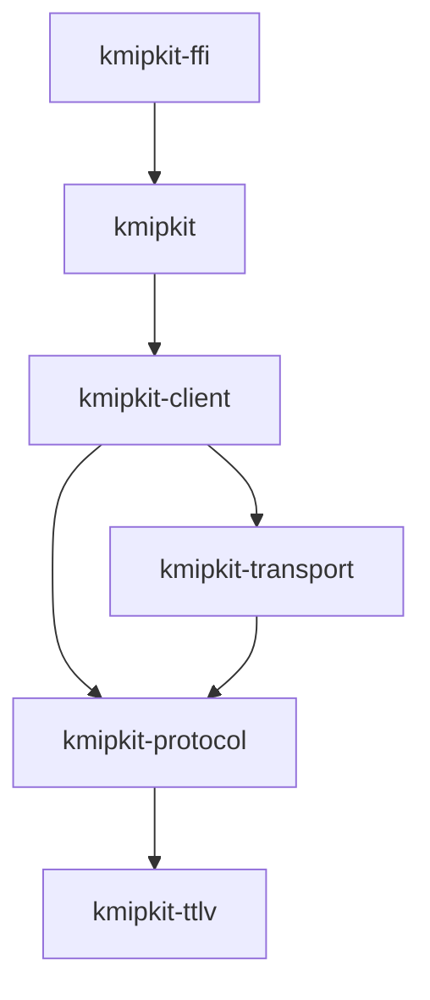

# 02. Architecture et Modèle de Sécurité

KMIPKit est conçu pour les environnements d'entreprise réglementés (banque, HSM de paiement, clouds souverains et gestion de clés à haute assurance). Chaque frontière de crate, règle de propriété mémoire et invariant de transport est vérifié à la compilation et par des contrôles de sécurité automatisés.

---

## 1. Architecture en Espaces de Travail Isolés

Le dépôt est divisé en **deux workspaces Cargo strictement isolés** :

```text
KMIPKit/
├── crates/                     # Workspace Client Principal (8 crates)
│   ├── kmipkit-ttlv/           # Modèle TTLV générique ordonné et borné & codec
│   ├── kmipkit-protocol/       # Catalogue normatif, modèles typés, validation de schéma, verrous de version
│   ├── kmipkit-transport/      # Adaptateurs mTLS Raw TLS et HTTPS/1.1, tampons zéroïsés
│   ├── kmipkit-client/         # Exécution synchrone, lots atomiques, résultats async, écouteurs S2C
│   ├── kmipkit/                # Façade Rust publique et Fluent Builders ergonomiques
│   ├── kmipkit-ffi/            # ABI C11 stable (SEULE crate autorisant `unsafe`)
│   ├── kmipkit-test-support/   # PKI éphémère, transports scriptés, fixtures (non publiée)
│   └── kmipkit-test-server/    # Serveur de test KMIP autonome multi-version
├── bindings/                   # Adaptateurs Natifs Multi-Langages
│   ├── c/                      # En-têtes C11, CMake, tests consommateurs ABI
│   ├── java/                   # Pont JNI C++ + API Java 17 idiomatique
│   └── python/                 # Pont CFFI + API Python 3.12 typée
└── kmip-proxy/                 # Workspace Proxy Autonome Indépendant
    ├── src/providers/          # 10 ponts Cloud / Enterprise KMS
    └── src/kmip1x/             # Pont de traduction KMIP 1.0–1.4 <-> KMIP 2.0/2.1/3.0
```

### Direction Stricte des Dépendances



* `kmipkit-proxy` dispose de ses propres `Cargo.toml` et `Cargo.lock`, garantissant que les SDK Cloud (`aws-sdk-kms`, `azure_security_keyvault_*`, `reqwest`, etc.) **ne fuitent jamais** dans la bibliothèque cliente KMIPKit ni dans ses paquets C/Java/Python.

---

## 2. Trois Niveaux d'API Supportés

KMIPKit expose trois niveaux d'API complémentaires — inspectables au runtime via `kmipkit::api_levels()` (Rust), `kmipkit_api_levels_get_v1` (C), `RuntimeMetadata.apiLevels()` (Java) et `kmipkit.metadata.get_api_levels()` (Python) :

| Niveau d'API | Rôle | Cas d'Usage Optimal |
| :--- | :--- | :--- |
| **1. Fluent Haut Niveau** | Builders orientés tâches (`create_symmetric_key()`, `encrypt()`, `activate()`, `revoke()`) | 90 % des intégrations applicatives d'entreprise. |
| **2. Protocole Typé** | `ClientBatch`, `ClientBatchItem`, `ClientRequest` explicites (59 opérations), `RequestOptions`, `validation_report()` | Lots atomiques multi-opérations, chaînage `ID Placeholder`, `Poll`/`Cancel`/`Process`. |
| **3. TTLV Générique** | Arbre ordonné `Item` / `Structure` / `Value` (`kmipkit-ttlv`) | Inspection de tags vendeurs inconnus, préservation exacte sur le fil, extensions ou proxies. |

---

## 3. Invariants de Transport et de Sécurité Cryptographique

### Politique TLS (`kmipkit-transport`)

| Contrôle de Sécurité | Politique Production par Défaut | Compatibilité Opt-In |
| :--- | :--- | :--- |
| **Version TLS** | **TLS 1.3 Uniquement** (`TlsVersionPolicy::Tls13Only`) | `Tls12And13Compat` (restreint strictement aux suites ECDHE-GCM des profils OASIS KMIP) |
| **Suites de Chiffrement (TLS 1.3)** | `TLS13_AES_256_GCM_SHA384`, `TLS13_CHACHA20_POLY1305_SHA256` | — |
| **Certificats Post-Quantiques** | **ML-DSA-44 / ML-DSA-65 / ML-DSA-87** via OpenSSL 3.5 | — |
| **Authentification** | **TLS Mutuel Obligatoire (mTLS)** | — |
| **Vérification de Certificats** | Chaîne + Validité + Hostname/SAN + CRL locales optionnelles | Aucun appel réseau OCSP/CRL ; aucun drapeau pour ignorer la vérification |
| **0-RTT / Early Data** | **Désactivé** (empêche le rejeu des mutations KMIP) | Non activable |
| **TLS Key Logging** | **Désactivé** (`SSLKEYLOGFILE` ignoré) | Non activable |
| **Reprise de Session** | Stockage mémoire borné (max 16 tickets, expiration 1 h) | Isolé par client ; jamais persisté sur disque |
| **Durcissement HTTP/1.1** | `POST /kmip` direct, un seul `Host`, sans redirections, sans proxies, sans compression | — |

### Propriété Mémoire, Zéroïsation et Masquage

1. **Zéroïsation à la Libération :** Clés privées, mots de passe, octets secrets, tampons temporaires et `TransportResponse` utilisent `zeroize::Zeroizing` / effacement explicite sur `Drop`.
2. **Masquage Total des Diagnostics :** Toute implémentation `Debug` et `Display` pour les identifiants, endpoints, erreurs TLS et TTLV affiche `[REDACTED]` ou des catégories sûres — jamais de clés brutes ni d'hôtes.
3. **Décodage Borné (`CodecLimits`) :** Les décodeurs TTLV, JSON et XML imposent des limites strictes (16 Mio par défaut, profondeur 64) **avant** toute allocation.
4. **Zéro `unsafe` hors FFI :** `#![forbid(unsafe_code)]` est imposé sur toutes les crates excepté `kmipkit-ffi`.

---

## 4. Garanties d'État de Livraison (Zéro Retry Automatique)

Les opérations cryptographiques (`Create`, `Re-key`, `Revoke`, `Destroy`) ne sont pas aveuglément idempotentes. KMIPKit **n'effectue jamais** de relance automatique. Chaque erreur de transport porte un `RequestDeliveryState` déterministe :

| `RequestDeliveryState` | Signification Exacte | Action Sûre de l'Appelant |
| :--- | :--- | :--- |
| **`NotSent`** | Échec local (validation, DNS, handshake TLS, limite preflight) avant qu'aucun octet ne sorte sur le fil. | Sûr pour corriger l'entrée ou réessayer immédiatement. |
| **`PossiblySent`** | Au moins un octet a été transmis à TLS, mais aucune réponse n'est arrivée avant timeout/reset. | État ambigu : interroger (`Locate`/`Get Attributes`) avant de réessayer. |
| **`ResponseStarted`** | Le serveur a commencé à répondre, puis le cadrage ou le timeout a échoué. | Le serveur a traité la requête ; réconcilier l'état avant toute action. |

---

## 5. Isolation des Handles ABI C et Confinement des Paniques

* **Handles Opaques Permutés :** Les pointeurs exportés sont des jetons générés par une **permutation de Feistel à 8 tours pilotée par une clé HMAC-SHA-256 aléatoire par processus**. Les pointeurs falsifiés ou libérés sont rejetés en toute sécurité.
* **Zéro Unwinding à travers FFI :** Chaque fonction `extern "C"` enveloppe son corps dans `std::panic::catch_unwind`, convertissant toute panique en `KMIPKIT_ERROR_INTERNAL (7)`.
* **Snapshots d'Erreur Thread-Local :** Inspectables via `kmipkit_last_error_get_v1()`.
