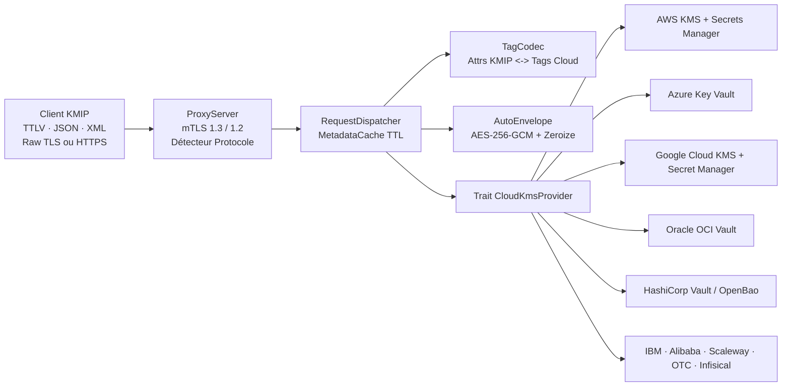

# 05. Guide du Proxy Cloud KMS KMIPKit

Les bases de données d'entreprise (MongoDB, MySQL, PostgreSQL, Oracle), hyperviseurs (VMware vSphere, Nutanix) et baies de stockage (NetApp, Dell EMC, Pure Storage, Ceph) exigent **OASIS KMIP** — alors que les KMS cloud publics exposent des API REST/gRPC propriétaires.

**`kmipkit-proxy`** est un **Sidecar Stateless sans Base de Données (Zero-DB)** qui traduit KMIP 2.0, 2.1 et 3.0 (ainsi que KMIP 1.X via le Pont Legacy) vers **10 fournisseurs KMS Cloud et Enterprise**.

---

## 1. Piliers Architecturaux Principaux



### Pilier 1 : Cloud Tag-Stuffing (`tag_codec.rs`)
Les services KMS Cloud ne stockent pas nativement les attributs KMIP (`State`, `Cryptographic Usage Mask`, `Activation Date`, `Name`, `Link`, etc.). `TagCodec` les sérialise en tags/labels cloud normalisés (`kmip_state`, `kmip_usage_mask`, `kmip_name_0`, etc.) en **RFC 4648 Base32Hex** découpés à `<= 60` caractères pour respecter les limites strictes (ex. 63 caractères sous GCP).

### Pilier 2 : Garde de Clé Auto-Envelope (`envelope.rs`)
De nombreuses applications attendent qu'un `Create` + `Get` retourne les octets AES-256 bruts. Trois modes (`key_custody_mode`) sont proposés :

| Mode | Comportement | Quand l'Utiliser |
| :--- | :--- | :--- |
| **`native_kms`** | Clés confinées dans le HSM Cloud. `Encrypt`/`Decrypt`/`Sign`/`Verify` exécutés côté Cloud. `Get` ne retourne que les clés publiques. | Conformité HSM maximale. |
| **`auto_envelope`** | Génère une DEK AES-256 en RAM zéroïsée, l'enveloppe en **AES-256-GCM** avec une Master KEK Cloud et stocke le blob dans le Secret Store. `Get` déchiffre à la volée. | Bases de données / baies (MongoDB, vSphere, NetApp) exigeant l'export de DEK via `Get`. |
| **`auto`** (défaut) | `auto_envelope` pour clés symétriques exportables ; `native_kms` pour clés HSM non exportables/asymétriques. | Charges d'entreprise mixtes. |

---

## 2. Fournisseurs Cloud et Enterprise Supportés (10 Backends)

| Fournisseur | Feature Cargo | Service KMS Natif | Secret Store (`AutoEnvelope`) | Variables d'Environnement Clés |
| :--- | :--- | :--- | :--- | :--- |
| **AWS** | `--features aws` | AWS KMS | AWS Secrets Manager | Chaîne standard AWS SDK |
| **Azure** | `--features azure` | Azure Key Vault Keys / Managed HSM | Azure Key Vault Secrets | `AZURE_TENANT_ID`, `AZURE_CLIENT_ID`, `AZURE_CLIENT_SECRET` |
| **Google Cloud** | `--features gcp` | Cloud KMS | Cloud Secret Manager | `GOOGLE_OAUTH_ACCESS_TOKEN` |
| **Oracle OCI** | `--features oci` | OCI Vault (Management + Crypto) | OCI Vault Secrets | `OCI_AUTH_TOKEN` |
| **HashiCorp Vault / OpenBao** | `--features vault` | Transit Secrets Engine | KV v2 Secrets Engine | `VAULT_TOKEN` |
| **Infisical** | `--features infisical` | Infisical KMS | Infisical Secrets | `INFISICAL_TOKEN` |
| **IBM Cloud** | `--features ibm` | IBM Key Protect | IBM Key Protect Standard Keys | `IBMCLOUD_API_KEY`, `IBM_AUTH_TOKEN` |
| **Alibaba Cloud** | `--features alibaba` | Alibaba Cloud KMS | Alibaba Secrets Manager | `ALIBABA_CLOUD_ACCESS_KEY_ID`, `ALIBABA_CLOUD_ACCESS_KEY_SECRET`, `ALIBABA_AUTH_TOKEN` |
| **Scaleway** | `--features scaleway` | Scaleway Key Manager | Scaleway Secret Manager | `SCW_SECRET_KEY`, `SCW_DEFAULT_PROJECT_ID` |
| **Open Telekom Cloud** | `--features otc` | OTC KMS (DEW) | OTC CSMS | `OTC_REGION`, `OTC_PROJECT_ID`, `OTC_AUTH_TOKEN` |

Compilation complète avec OpenSSL épinglé :
```bash
python3 verification/security/openssl/build.py
export OPENSSL_DIR="$HOME/.cache/kmipkit/openssl/3.5.9"
export OPENSSL_STATIC=1
cargo build --release --manifest-path kmip-proxy/Cargo.toml --features all-clouds
```

> **CLI vs Instanciation Bibliothèque :** Le binaire CLI `kmipkit-proxy` (`kmip-proxy/src/main.rs`) instancie directement `kmip-upstream`, `mock`, `aws`, `azure`, `gcp` et `oci`. Pour utiliser `vault`, `infisical`, `ibm`, `alibaba`, `scaleway` ou `otc`, utilisez `kmipkit_proxy::providers::create_provider(&config.backend)`.

---

## 3. Détection de Protocole, TLS & Opérations KMIP Supportées

* **Détecteur mono-port :** Lit le premier octet (`0x42` → Raw TTLV ; `'P'`/`'p'` → HTTP/1.1 `POST` vers `application/octet-stream`, `application/json` ou `text/xml`/`application/xml` avec keep-alive).
* **Limites & Sûreté :** En-têtes HTTP limités à `16 KiB`, trames TTLV/HTTP/JSON à `16 MiB`, profondeur JSON à `64`, et `#![forbid(unsafe_code)]`.
* **Certificats PEM/DER & AutoPKI :** Prend en charge **PEM et DER** pour certificats, clés privées et CA ; génère `AutoPki` si `tls_cert_path` est omis.
* **Opérations KMIP (`RequestDispatcher`) :** `Create`, `Create Key Pair`, `Register`, `Locate`, `Get`, `Activate`, `Revoke`, `Destroy`, `Deactivate`, `Get Attributes`, `Get Attribute List`, `Add/Modify/Delete Attribute`, `Encrypt`, `Decrypt`, `Sign`, `Signature Verify`, `MAC`, `MAC Verify`, `RNG Retrieve`, `Query`, `Discover Versions`, `Ping`.

---

## 4. Exemples de Configuration & CLI (`proxy.toml`)

### Exemple A : AWS KMS + Secrets Manager

```toml
[listener]
bind_addr = "0.0.0.0:5696"
tls_enabled = true
require_client_cert = true
tls_cert_path = "/etc/kmip-proxy/server.crt"
tls_key_path = "/etc/kmip-proxy/server.key"
tls_client_ca_path = "/etc/kmip-proxy/client-ca.crt"

[proxy_behavior]
key_custody_mode = "auto"
metadata_cache_ttl_secs = 5

[backend]
provider = "aws"

[backend.aws]
region = "eu-west-1"
envelope_master_kek_id = "arn:aws:kms:eu-west-1:123456789012:key/mrk-1234abcd"
secret_name_prefix = "kmipkit/"
```

### Exemple B : HashiCorp Vault / OpenBao (via `create_provider`)

```toml
[listener]
bind_addr = "0.0.0.0:5696"
tls_enabled = true
require_client_cert = true

[backend]
provider = "vault"

[backend.vault]
endpoint_url = "https://vault.internal.example.com:8200"
namespace = "prod-kms"
transit_mount = "transit"
kv_v2_mount = "secret"
item_prefix = "kmipkit/"
allow_transit_export = true
auth_method = "approle"
role_id = "your-approle-id"
role_cred = "your-approle-secret"
```

### Lancement & Options CLI

```bash
kmipkit-proxy --config /etc/kmip-proxy/proxy.toml
```

Options CLI : `-c/--config`, `-l/--listen`, `-p/--provider`, `--upstream-endpoint`, `--upstream-version`, `--allow-tls12`, `--master-kek-hex`, `--no-client-auth`, `--no-tls`. Référence détaillée dans [`kmip-proxy/docs/configuration-and-providers.md`](../../kmip-proxy/docs/configuration-and-providers.md).
