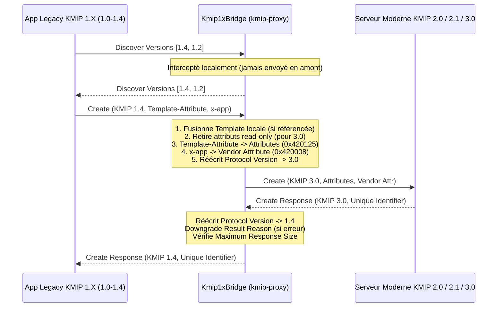

# 06. Guide du Pont Legacy KMIP 1.X (1.0–1.4) vers KMIP 2.0 / 2.1 / 3.0

Les logiciels d'entreprise legacy (anciennes versions MongoDB/Oracle/MySQL, lecteurs de bandes, baies de stockage et commutateurs bancaires) utilisent fréquemment **KMIP 1.0, 1.1, 1.2, 1.3 ou 1.4**, alors que les HSM et serveurs KMS modernes exigent **KMIP 2.0, 2.1 ou 3.0**.

Le module **`kmip1x`** de `kmip-proxy` (activé par défaut via `kmip1x-bridge`) fournit un **proxy de traduction protocolaire bidirectionnel et transparent** ne nécessitant **aucune modification des applications legacy**.

---

## 1. Architecture de Traduction (C2S & S2C)



---

## 2. Matrice Complète de Traduction Protocolaire

| Concept KMIP 1.0–1.4 | Équivalent KMIP 2.0 / 2.1 / 3.0 | Comportement du Pont (`src/kmip1x/`) |
| :--- | :--- | :--- |
| **`Attribute` (`0x420008`)** `{ Name, Index?, Value }` | **`Attributes` (`0x420125`)** à tags directs | Conversion bidirectionnelle complète des **77 attributs standard KMIP 1.0–1.4** (y compris dans `Key Block` `->` `Key Value`). |
| **`Template-Attribute`** (`Common`/`Private`/`Public`) | **`Attributes`** (`0x420125..=0x420128`) | Traduction automatique ; fusionne les attributs des objets `Template` stockés localement. |
| **`Template` (`0x06`)** | *Supprimé en KMIP 2.0* | Émulé localement via `TemplateStore` thread-safe (en mémoire ou avec persistance JSON atomique optionnelle via `template_store_path`). |
| **`Add Attribute` (`0x0D`)** | `Set Attribute` (`0x31`) ou `Add Attribute` (`0x0D`) | Routé par cardinalité : `SingleInstance` `->` `Set Attribute` ; `MultiInstance` `->` `Add Attribute`. Réponse restaurée en `0x0D`. |
| **`Modify/Delete Attribute` avec `Attribute Index`** | `Current Attribute` (`0x42013C`) + `New Attribute` (`0x42013D`) | **Read-Modify-Write automatique** : `Get Attributes` `->` résolution exacte par index (standard, custom ou liens KMIP 3.0) `->` `Modify`/`Delete`. |
| **Attributs custom `x-*` / `y-*`** | **Vendor Attribute** (`0x420008` + `Vendor Identification`) | Mappage bidirectionnel sans perte (`x-dept` `<->` `{ Vendor: "x", Name: "dept" }`). |
| **KMIP 1.X `Link` (`0x42004A`)** | **Liens typés KMIP 3.0 (`0x420190..=0x42019D`)** | Les 14 types de liens sont convertis bidirectionnellement vers KMIP 3.0. |
| **`ID Placeholder` implicite** | `Unique Identifier = Enumeration(1)` ou UID chaîné | Injecté automatiquement dans les lots atomiques et lots mixtes orchestrés. |
| **`Operation Policy Name`** | *Supprimé en KMIP 2.0* | Configurable : `ignore` (défaut), `store_as_vendor_attribute`, ou `reject`. |
| **`Discover Versions` (`0x1E`)** | Annonce `2.0 / 2.1 / 3.0` | Intercepté localement ; renvoie l'intersection avec `[1.4, 1.3, 1.2, 1.1, 1.0]`. |
| **`Query` (`0x18`)** | Inclut ops 2.0/3.0 et PQC | Filtré par version (`1.0`..`1.4`), en retirant `Set Attribute`, `ML-KEM`, `ML-DSA`, `Quantum Safe Capability`. |
| **`Result Reason` (`0x17..=0x4D`)** | Codes étendus 2.0 / 2.1 / 3.0 | Rétrogradé vers le code KMIP 1.X valide le plus proche. |
| **`Maximum Response Size`** | Appliqué en amont | Ré-appliqué sur la trame **TTLV KMIP 1.X finale** ; renvoie `Response Too Large (0x02)` si dépassé. |
| **Pass-Through (`major >= 2`)** | KMIP 2.0 / 2.1 / 3.0 natif | Transmission directe sans surcharge pour clients modernes. |

---

## 3. Configuration & Déploiement

### Configuration TOML (`kmip1x-bridge.toml`)

```toml
[listener]
bind_addr = "0.0.0.0:5696"
tls_enabled = true
# Active TLS 1.2 + TLS 1.3 pour les clients legacy (PEM ou DER sur disque)
allow_tls12 = true
require_client_cert = true
tls_cert_path = "/etc/kmip-bridge/listener.crt"
tls_key_path = "/etc/kmip-bridge/listener.key"
tls_client_ca_path = "/etc/kmip-bridge/legacy-clients-ca.crt"

[backend]
provider = "kmip-upstream"

[backend.kmip_upstream]
endpoint = "hsm-kms.internal.example.com:5697"
target_version = "3.0"
wire_encoding = "ttlv"
client_cert_path = "/etc/kmip-bridge/upstream-client.crt"
client_key_path = "/etc/kmip-bridge/upstream-client.key"
ca_cert_path = "/etc/kmip-bridge/upstream-ca.crt"
allow_tls12 = false
timeout_secs = 30
operation_policy_mode = "ignore"
max_connections = 8
# Optionnel : persister les objets Template KMIP 1.X sur disque
# template_store_path = "/var/lib/kmip-bridge/templates.json"
```

### Lancement rapide en CLI

```bash
kmipkit-proxy --config /etc/kmip-bridge/kmip1x-bridge.toml

# Ou via arguments CLI :
kmipkit-proxy \
  --listen 0.0.0.0:5696 \
  --provider kmip-upstream \
  --upstream-endpoint hsm-kms.internal:5697 \
  --upstream-version 3.0 \
  --allow-tls12
```

---

## 4. Intégration Programmatique & Chaînage avec Cloud KMS

```rust
use std::sync::Arc;
use kmipkit_proxy::{
    Kmip1xBridge, LocalDispatcherUpstream, ProxyBehaviorConfig, ProxyConfig, ProxyServer,
    RequestDispatcher, UpstreamKmipVersion,
};

let cloud_dispatcher = Arc::new(RequestDispatcher::new(
    cloud_provider,
    ProxyBehaviorConfig::default(),
));
let bridge = Arc::new(Kmip1xBridge::new(
    Arc::new(LocalDispatcherUpstream::new(cloud_dispatcher)),
    UpstreamKmipVersion::V2_1,
));

let handle = ProxyServer::start_kmip1x_bridge(proxy_config, bridge).await?;
```

---

## 5. Pont Server-to-Client (`Kmip1xS2cBridge`)

Pour les serveurs KMIP 2.0/2.1/3.0 initiant `Notify`, `Put`, `Query` ou `Discover Versions` vers un client KMIP 1.X legacy, `kmipkit_proxy::Kmip1xS2cBridge` traduit les requêtes S2C vers 1.X et restaure les réponses 1.X vers la version du serveur.
