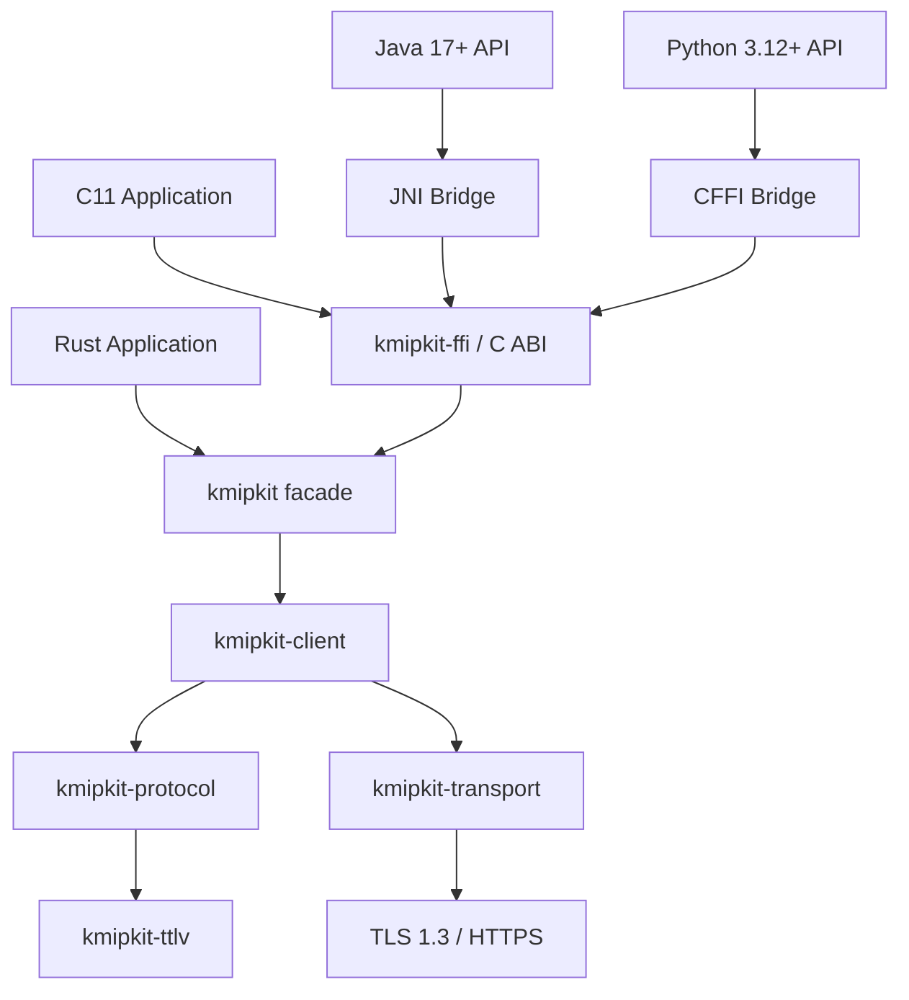

This section documents the internal engine architecture of KMIPKit according to [ADR-0001](../compliance/conformance-and-adrs/#adr-0001) and [ADR-0003](../compliance/conformance-and-adrs/#adr-0003).

---

## 1. Workspace Dependency Graph

---

## 2. Crate Responsibilities

1. **`kmipkit-ttlv`**:
   - Generic TTLV tree representation, strict canonical encoder, and decoder enforcing resource limits (depth, frame sizes).
   - Contains no network I/O and no KMIP operation semantics.
2. **`kmipkit-protocol`**:
   - Strongly-typed models, enums, and structural validation for KMIP 2.1.
   - Lossless roundtrip conversion to/from generic TTLV.
3. **`kmipkit-transport`**:
   - Synchronous network transport for Raw TLS 1.3 (`TcpStream` + `rustls`) and HTTPS (`reqwest::blocking` + `rustls`).
   - Timeout handling, delivery state classification, and redacted logging.
4. **`kmipkit-client`**:
   - Client connection lifecycle, request header creation, response batch correlation, and asynchronous handles.
5. **`kmipkit`**:
   - High-level ergonomic Rust facade re-exporting approved types and operation builders.
6. **`kmipkit-ffi`**:
   - C ABI with fixed-width types and opaque handles. **The only crate in the workspace allowed to use `unsafe`**, with mandatory `SAFETY` comments.
   - Catches all Rust panics at function boundaries (`catch_unwind`) to prevent undefined behavior across foreign language boundaries.
7. **`kmipkit-test-server`**:
   - Standalone multi-version test server supporting KMIP 1.0–2.1 with autonomous PKI and JSON persistence.
