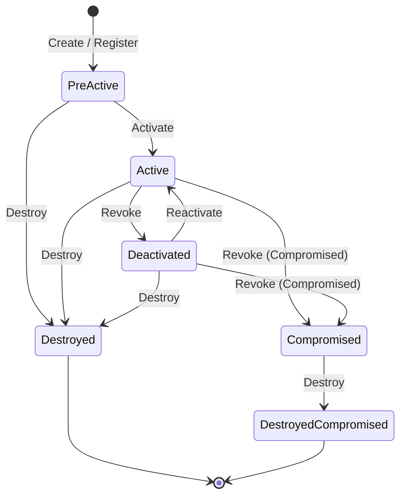

The lifecycle of every managed cryptographic object in KMIP strictly follows the state machine defined by **NIST SP 800-57 Part 1** and OASIS KMIP specifications.

---

## 1. State Transition Diagram

---

## 2. State Semantics and Permitted Operations

| State | Semantic Meaning | Permitted Operations |
| :--- | :--- | :--- |
| **Pre-Active** | Created but not yet authorized for operational production use. | `AdjustAttribute`, `Activate`, `Destroy`, `Get` |
| **Active** | In active production, authorized for cryptographic usage defined in `CryptographicUsageMask`. | `Encrypt`, `Decrypt`, `Sign`, `Verify`, `Revoke`, `Destroy`, `Get` |
| **Deactivated** | Temporarily or permanently retired from active use. Cannot encrypt new data. | `Decrypt` (historical read-only access), `Destroy`, `Archive`, `Recover` |
| **Compromised** | The key has been leaked or suspected compromised. | `Decrypt` (with high-risk audit warnings), `Destroy` |
| **Destroyed** | Key material has been purged from KMS storage. Metadata retained for compliance. | `GetAttributes`, `GetAttributeList` |
| **Destroyed Compromised** | Key material purged following confirmed compromise. | Audit metadata read-only access |
