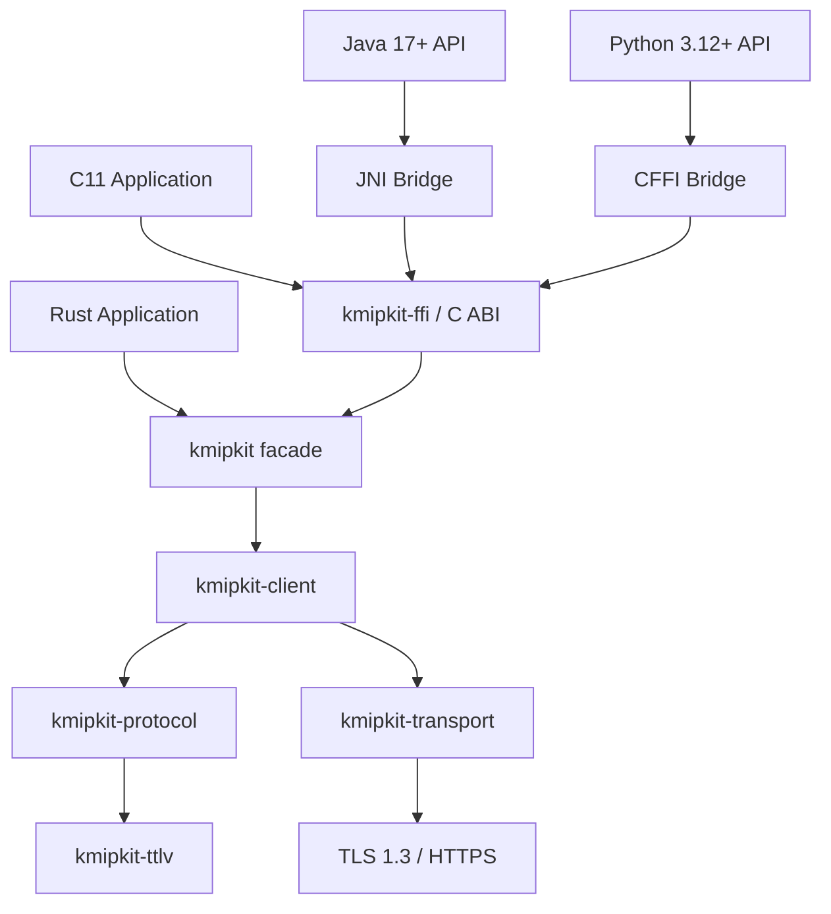

Esta sección documenta la arquitectura interna del motor de KMIPKit conforme a [ADR-0001](../compliance/conformance-and-adrs/#adr-0001) y [ADR-0003](../compliance/conformance-and-adrs/#adr-0003).

---

## 1. Grafo de Dependencias del Workspace

---

## 2. Responsabilidades por Crate

1. **`kmipkit-ttlv`**:
   - Modelado de nodos TTLV genéricos, parser estricto con límites de profundidad y framing a múltiplos de 8 bytes.
   - Prohibido realizar I/O o contener lógica de negocio de KMIP.
2. **`kmipkit-protocol`**:
   - Estructuras tipadas, enumeraciones y validación de invariantes del protocolo KMIP 2.1.
   - Conversión bidireccional hacia/desde TTLV genérico.
3. **`kmipkit-transport`**:
   - Implementación de red Raw TLS 1.3 (`TcpStream` + `rustls`) y HTTPS (`reqwest::blocking` + `rustls`).
   - Manejo de timeouts, reconexiones y trazado de eventos con datos sensibles redactados.
4. **`kmipkit-client`**:
   - Orquestación de peticiones, correlación de respuestas por ID, procesamiento de lotes y handles para operaciones asíncronas.
5. **`kmipkit`**:
   - Fachada pública en Rust con constructores ergonómicos de alto nivel y re-exportación de tipos soportados.
6. **`kmipkit-ffi`**:
   - C ABI estable. **El único crate del workspace que permite código `unsafe`**, encapsulado y con explicaciones `SAFETY`.
   - Atrapa todos los pánicos de Rust en la frontera (`catch_unwind`) para evitar comportamiento indefinido en C.
7. **`kmipkit-test-server`**:
   - Servidor simulador de pruebas multi-versión (1.0..2.1) con auto-PKI y persistencia en JSON.
