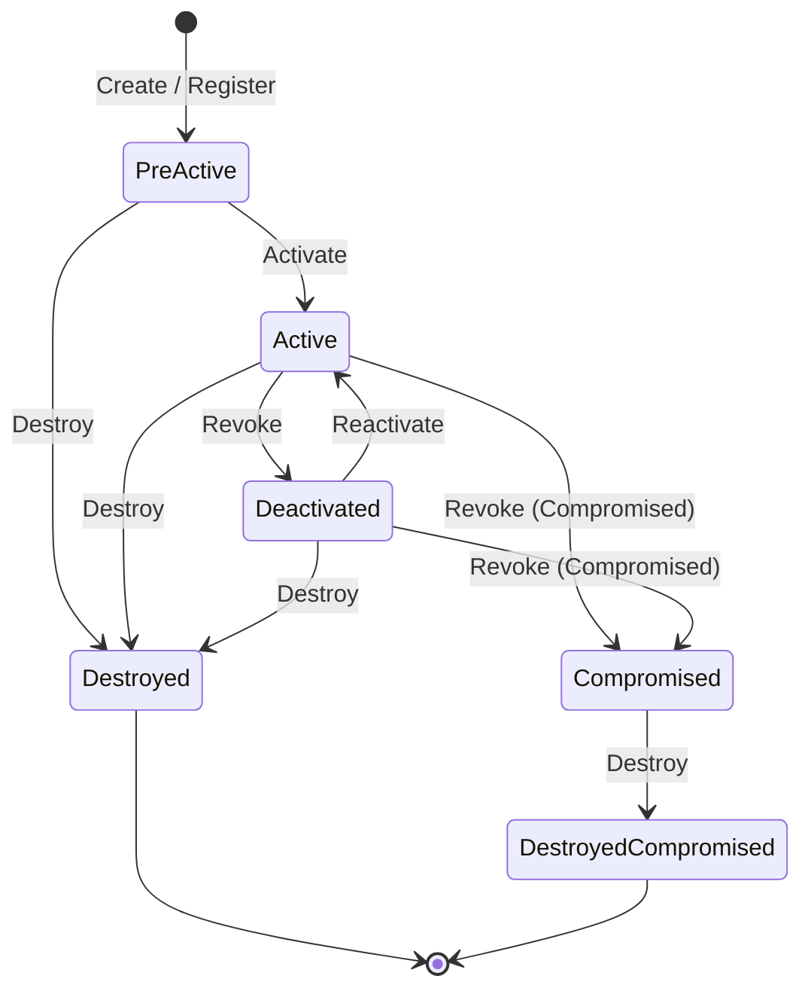

El ciclo de vida de todo objeto criptográfico en KMIP sigue la máquina de estados definida por **NIST SP 800-57 Parte 1** y la especificación de OASIS KMIP.

---

## 1. Diagrama de Transición de Estados

---

## 2. Descripción de Estados y Operaciones Permitidas

| Estado | Significado | Operaciones Permitidas |
| :--- | :--- | :--- |
| **Pre-Active** | Creada pero no lista para uso en producción. Fechas y atributos modificables. | `AdjustAttribute`, `Activate`, `Destroy`, `Get` |
| **Active** | Clave en producción autorizada para operaciones criptográficas según su `CryptographicUsageMask`. | `Encrypt`, `Decrypt`, `Sign`, `Verify`, `Revoke`, `Destroy`, `Get` |
| **Deactivated** | Retirada temporal o definitivamente de producción. No puede cifrar nuevo material. | `Decrypt` (lectura histórica), `Destroy`, `Archive`, `Recover` |
| **Compromised** | La clave ha sufrido fuga o sospecha de compromiso. | `Decrypt` (con advertencia de seguridad), `Destroy` |
| **Destroyed** | El material criptográfico ha sido eliminado del KMS. Solo se conservan metadatos. | `GetAttributes`, `GetAttributeList` |
| **Destroyed Compromised** | El material criptográfico fue eliminado tras ser comprometido. | Solo lectura de metadatos de auditoría |
