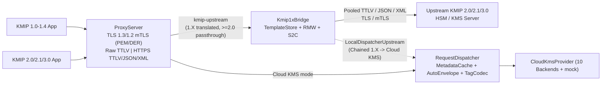

# KMIPKit Proxy (`kmipkit-proxy`)

Standalone, **Zero-DB stateless KMIP service** with `#![forbid(unsafe_code)]` that serves two primary roles from a single TLS/HTTP/TTLV listener:

1. **Cloud & Enterprise KMS Proxy (`RequestDispatcher`)**: Translates OASIS KMIP 2.0, 2.1, and 3.0 operations into native API calls across **10 cloud and enterprise KMS providers** (plus an in-memory `mock` backend) without any external metadata database.
2. **KMIP 1.X Legacy Protocol Bridge (`Kmip1xBridge` & `Kmip1xS2cBridge`)**: Translates bidirectional **KMIP 1.0–1.4 ↔ KMIP 2.0 / 2.1 / 3.0** traffic between legacy KMIP clients (databases, hypervisors, storage arrays, switches) and modern KMIP servers—or directly chains legacy KMIP 1.X clients into any Cloud KMS backend.

This crate maintains its own `Cargo.toml` and `Cargo.lock` outside the core Rust workspace so cloud SDK dependencies (AWS SDK, Azure SDK, `reqwest`) remain isolated from core `kmipkit` crates and FFI bindings.

---

## Documentation Map

| Guide | Audience & Contents |
| :--- | :--- |
| [Architecture & Security](docs/architecture-and-security.md) | Dual-mode pipeline, single-port wire sniffing (TTLV / JSON / XML), TLS 1.2/1.3 & PEM/DER loader, AutoPKI, TagCodec Base32Hex, AutoEnvelope AES-256-GCM, pooling, size bounds, Rust embedding. |
| [Configuration & Providers](docs/configuration-and-providers.md) | Complete CLI flag reference, full `proxy.toml` schema (`[listener]`, `[proxy_behavior]`, `[backend.kmip_upstream]`), and configuration/env vars for all 10 Cloud/Enterprise backends. |
| [KMIP 1.X Bridge Reference](docs/kmip1x-bridge-reference.md) | Full protocol matrix (1.0–1.4 ↔ 2.0/2.1/3.0), `TemplateStore` JSON persistence, `ID Placeholder` chaining, RMW attribute resolution, `Key Block`/`Key Value`, 77 attributes, 14 typed links, S2C, chained Cloud KMS. |
| [Testing & Troubleshooting](docs/testing-and-troubleshooting.md) | OpenSSL 3.5.9 build setup, per-provider Cargo feature checks, all 7 KMIP 1.X bridge test suites (83 tests), strict Rustdoc check, and common operational diagnostics. |

Portal guides across 4 languages are also available under [`docs/en/05-kmip-proxy-cloud-kms.md`](../docs/en/05-kmip-proxy-cloud-kms.md) and [`docs/en/06-kmip1x-legacy-bridge.md`](../docs/en/06-kmip1x-legacy-bridge.md) (with `es`, `fr`, and `de` equivalents).

---

## High-Level Architecture



---

## Quick Start

### 1. Build Prerequisites (Checksum-Pinned OpenSSL)

`kmipkit-proxy` uses OpenSSL for cryptographic primitives and as the `rustls` crypto provider (`rustls-openssl`), including AWS SDK and Azure `reqwest` HTTP transports. Build and export the repository's pinned OpenSSL installation before compiling:

```sh
python3 verification/security/openssl/build.py
export OPENSSL_DIR="$HOME/.cache/kmipkit/openssl/3.5.9"
export OPENSSL_STATIC=1
```

Build with default features (`kmip1x-bridge` enabled) or enable specific/all cloud backends:

```sh
# Default binary (KMIP 1.X bridge + in-memory mock provider):
cargo build --release --manifest-path kmip-proxy/Cargo.toml

# Specific cloud providers:
cargo build --release --manifest-path kmip-proxy/Cargo.toml --features "kmip1x-bridge,aws,gcp"

# All 10 cloud/enterprise providers + KMIP 1.X bridge:
cargo build --release --manifest-path kmip-proxy/Cargo.toml --features all-clouds
```

### 2. Mode A — KMIP 1.X Legacy Bridge to Modern KMIP 2.0/2.1/3.0 Server

Create `kmip1x-bridge.toml`:

```toml
[listener]
bind_addr = "0.0.0.0:5696"
tls_enabled = true
allow_tls12 = true
require_client_cert = true
tls_cert_path = "/etc/kmip-bridge/listener.pem"
tls_key_path = "/etc/kmip-bridge/listener.key"
tls_client_ca_path = "/etc/kmip-bridge/legacy-clients-ca.pem"

[backend]
provider = "kmip-upstream"

[backend.kmip_upstream]
endpoint = "hsm-kms.internal.example.com:5697"
target_version = "3.0"
wire_encoding = "ttlv"
client_cert_path = "/etc/kmip-bridge/upstream-client.pem"
client_key_path = "/etc/kmip-bridge/upstream-client.key"
ca_cert_path = "/etc/kmip-bridge/upstream-ca.pem"
allow_tls12 = false
timeout_secs = 30
max_connections = 16
operation_policy_mode = "ignore"
template_store_path = "/var/lib/kmip-bridge/templates.json"
```

Run:

```sh
cargo run --manifest-path kmip-proxy/Cargo.toml -- --config kmip1x-bridge.toml
```

### 3. Mode B — Cloud KMS Proxy

Create `cloud-proxy.toml` (for example with AWS KMS + Secrets Manager):

```toml
[listener]
bind_addr = "0.0.0.0:5696"
tls_enabled = true
require_client_cert = true
tls_cert_path = "/etc/kmip-proxy/server.pem"
tls_key_path = "/etc/kmip-proxy/server.key"
tls_client_ca_path = "/etc/kmip-proxy/clients-ca.pem"

[proxy_behavior]
key_custody_mode = "auto"
metadata_cache_ttl_secs = 5

[backend]
provider = "aws"

[backend.aws]
region = "eu-west-1"
envelope_master_kek_id = "arn:aws:kms:eu-west-1:123456789012:key/mrk-1234abcd"
secret_name_prefix = "kmipkit/"
```

Run:

```sh
cargo run --manifest-path kmip-proxy/Cargo.toml --features aws -- --config cloud-proxy.toml
```

> **Note on CLI vs Library Provider Wiring:** The CLI binary (`src/main.rs`) directly constructs `kmip-upstream`, `mock`, `aws`, `azure`, `gcp`, and `oci` (falling back to `mock` for other names). All 10 cloud/enterprise backends (`aws`, `azure`, `gcp`, `oci`, `vault`, `infisical`, `ibm`, `alibaba`, `scaleway`, `otc`) are implemented behind their Cargo features and instantiated via `kmipkit_proxy::providers::create_provider(&config.backend)`. See [Configuration & Providers](docs/configuration-and-providers.md).

---

## Cargo Features & CLI Summary

| Feature Flag | Default | Purpose |
| :--- | :---: | :--- |
| `kmip1x-bridge` | Yes | Enables `kmip1x` (`Kmip1xBridge`, `Kmip1xS2cBridge`, `KmipKitUpstreamTransport`, `LocalDispatcherUpstream`, `TemplateStore`). |
| `aws`, `azure`, `gcp`, `oci`, `vault`, `infisical`, `ibm`, `alibaba`, `scaleway`, `otc` | No | Enables each respective cloud/enterprise KMS provider backend. |
| `all-clouds` | No | Enables `kmip1x-bridge` plus all 10 cloud/enterprise provider features. |

**CLI Flags (`kmipkit-proxy`):**

| Flag | Overrides TOML Key | Description |
| :--- | :--- | :--- |
| `-c, --config <PATH>` | *(base file)* | Path to TOML configuration file (optional; defaults apply if omitted). |
| `-l, --listen <ADDR>` | `listener.bind_addr` | Socket address to bind (default `127.0.0.1:5696`). |
| `-p, --provider <NAME>` | `backend.provider` | Provider selector (`kmip-upstream`, `mock`, `aws`, `azure`, `gcp`, `oci`, ...). |
| `--upstream-endpoint <EP>` | `backend.kmip_upstream.endpoint` | Upstream KMIP server (`host:port` or `https://host:port/kmip`). |
| `--upstream-version <VER>` | `backend.kmip_upstream.target_version` | Target upstream KMIP version (`2.0`, `2.1`, or `3.0`; default `2.1`). |
| `--allow-tls12` | `listener.allow_tls12 = true` | Enables TLS 1.2 + TLS 1.3 on the listener for legacy clients. |
| `--master-kek-hex <HEX>` | `backend.master_kek_hex` | 32-byte (64-hex-char) Master KEK for local auto-envelope wrapping. |
| `--no-client-auth` | `listener.require_client_cert = false` | Disables client mTLS certificate verification (dev/test only). |
| `--no-tls` | `listener.tls_enabled = false` | Disables TLS and listens over plain TCP (dev/test only). |

---

## Wire Protocols, Security & Hardening Defaults

* **Single-port Protocol Sniffing**: Reads the first byte of each connection stream:
  * `0x42` → Raw KMIP TTLV stream framing.
  * `'P'` / `'p'` → HTTP/1.1 `POST` with `Content-Type` dispatch (`application/octet-stream` → TTLV, `application/json` → KMIP JSON, `text/xml` / `application/xml` → KMIP XML) and HTTP keep-alive reuse.
* **Frame & Depth Limits**: Caps TTLV frames, HTTP bodies, and upstream JSON payloads at `16 MiB`; HTTP request headers at `16 KiB`; KMIP JSON parser recursion at depth `64`; and uses `decode_allow_reserved` to accept legacy KMIP 1.X reserved tags such as `Template-Attribute (0x420091)`.
* **Certificate Format Auto-Detection**: Listener and upstream certificates, private keys (`PKCS#8` / RSA / EC), and CAs accept **both PEM and DER** transparently. If `tls_enabled = true` and `tls_cert_path` is unset, `ProxyServer` generates an ephemeral in-memory `AutoPki` (accessible via `ProxyServerHandle::pki()`).
* **Memory Safety & Zeroization**: `#![forbid(unsafe_code)]` across the entire crate; ephemeral DEKs, master KEKs, random bytes, and credentials use `zeroize::Zeroizing` where handled in proxy memory.

---

## Running Tests & Documentation Builds

```sh
# Core proxy + KMIP 1.X bridge suites (83 tests total with kmip1x-bridge):
cargo test --manifest-path kmip-proxy/Cargo.toml --features kmip1x-bridge --tests

# Format & strict Clippy:
cargo fmt --manifest-path kmip-proxy/Cargo.toml --check
cargo clippy --manifest-path kmip-proxy/Cargo.toml --features kmip1x-bridge --all-targets -- -D warnings

# Per-provider tests (using local mock servers):
cargo test --manifest-path kmip-proxy/Cargo.toml --features aws
cargo test --manifest-path kmip-proxy/Cargo.toml --features azure
cargo test --manifest-path kmip-proxy/Cargo.toml --features gcp
cargo test --manifest-path kmip-proxy/Cargo.toml --features vault

# Strict Rustdoc verification:
RUSTDOCFLAGS="--cfg docsrs -D warnings" cargo doc --manifest-path kmip-proxy/Cargo.toml --no-deps
```

*Provider tests run against local in-process mock HTTP/KMS endpoints, except the AWS LocalStack integration test which is disabled in source by default because it requires an external LocalStack service.*
