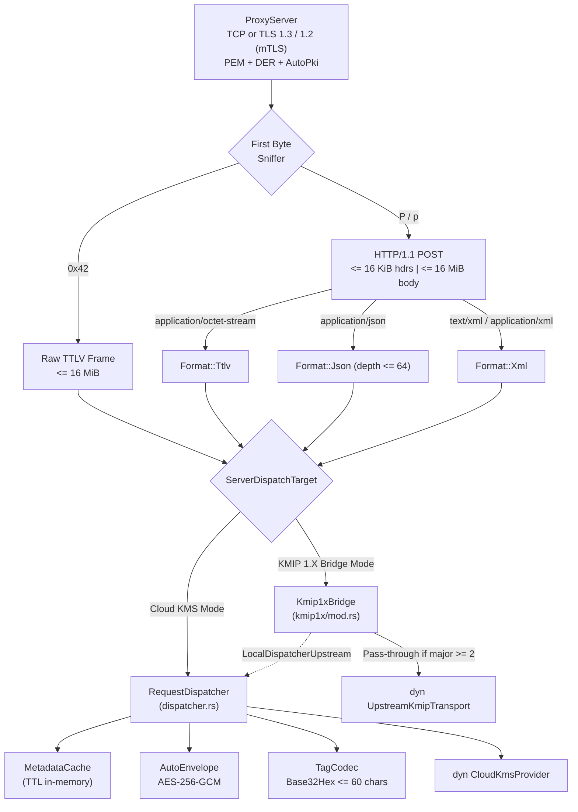

# Proxy Architecture & Security Model

This guide details the internal pipeline, wire transport handling, cryptographic custody design, metadata caching, and security guarantees of `kmipkit-proxy`.

---

## 1. Dual-Mode Dispatch Architecture

`kmip-proxy` cleanly separates transport parsing (`server.rs`) from protocol/provider execution via two dispatch targets selected at startup (`main.rs` or programmatic embedding):



---

## 2. Single-Port Wire & HTTP Protocol Sniffing (`src/server.rs`)

Every accepted socket (plain TCP or TLS-terminated) runs an event loop in `handle_connection_target` that reads the first byte of each message:

| Leading Byte | Detected Framing | Response Framing | Connection Lifecycle |
| :--- | :--- | :--- | :--- |
| `0x42` | **Raw KMIP TTLV** | Raw KMIP TTLV (`Format::Ttlv::encode`) | Loops for multiple consecutive KMIP requests on the same socket until client EOF. |
| `'P'` or `'p'` | **HTTP/1.1 `POST`** | `HTTP/1.1 200 OK` with matching `Content-Type` | Persistent HTTP keep-alive by default unless `Connection: close` (case-insensitive) is present. |
| Anything else | Rejected cleanly | Terminates connection with error | Avoids buffering arbitrary non-KMIP traffic. |

### HTTP Content-Type Negotiation (`src/codec/`)

Within `handle_http`, `kmipkit-proxy` dispatches body encoding by header `Content-Type`:

* `application/json` → KMIP JSON (`Format::Json`, recursion & structure limits enforced at depth `64`).
* `text/xml` or `application/xml` → KMIP XML (`Format::Xml`, parsed via `roxmltree`).
* `application/octet-stream` (or fallback binary MIME) → Binary KMIP TTLV (`Format::Ttlv`).

### Hard Size & Resource Bounds

| Bound | Enforcement Location | Limit |
| :--- | :--- | :--- |
| HTTP request headers | `server.rs` (`handle_http`) | `16 KiB` (`16 * 1024` bytes) before `\r\n\r\n`. |
| HTTP `Content-Length` | `server.rs` (`handle_http`) | Strict unsigned integer parsing (rejects malformed/duplicate lengths) and `16 MiB` (`16 * 1024 * 1024` bytes) body ceiling. |
| Raw TTLV payload & padded frame | `server.rs` (`handle_raw_ttlv`) | `16 MiB` (`16 * 1024 * 1024` bytes) preflight before allocation. |
| Upstream JSON frame | `codec/json.rs` | `16 MiB` ceiling + max recursion depth `64`. |
| Legacy reserved KMIP tags | `codec/ttlv.rs`, `kmip1x/ttlv_helpers.rs` | Uses `kmipkit_ttlv::decode_allow_reserved` to parse KMIP 1.X tags marked reserved in KMIP 2.0+ (e.g. `Template-Attribute 0x420091`). |

---

## 3. TLS, Mutual TLS & Ephemeral AutoPKI (`src/server.rs`, `src/pki.rs`)

### Certificate & Private Key Loading (PEM + DER)

`ProxyServer` and `KmipKitUpstreamTransport` both auto-detect **PEM** and **DER** encodings when reading certificate chains, leaf certificates, CA roots, and private keys (`PKCS#8`, RSA, and EC keys parsed cleanly through `openssl::x509::X509` and `openssl::pkey::PKey` without brittle file-extension assumptions).

### Protocol Versions & Client Auth

* **TLS 1.3 by default**: With `allow_tls12 = false` (default), only TLS 1.3 cipher suites/versions are negotiated.
* **Legacy TLS 1.2 opt-in**: Setting `listener.allow_tls12 = true` (or `--allow-tls12`) enables TLS 1.2 + TLS 1.3 for older KMIP 1.0–1.4 appliances. Upstream TLS 1.2 compatibility is configured independently via `backend.kmip_upstream.allow_tls12`.
* **Mutual TLS (`require_client_cert = true`)**: Enforced by default against either `listener.tls_client_ca_path` or the generated `AutoPki` CA.

### Zero-Config Ephemeral `AutoPki`

When `listener.tls_enabled = true` and `listener.tls_cert_path` is omitted (`None`), `ProxyServer::start` and `ProxyServer::start_kmip1x_bridge` generate an in-memory PKI hierarchy via `AutoPki::generate()`:

* Self-signed internal Root CA
* Server leaf certificate (with SANs for `localhost`, `127.0.0.1`)
* Client leaf certificate + private key for immediate mTLS onboarding or automated testing

Callers can inspect `handle.pki()` or persist PEM bundles to disk with `pki.export_to_directory(path)`.

---

## 4. Cloud KMS Custody, Caching & Tag-Stuffing

### Supported KMIP Operations in `RequestDispatcher` (`src/dispatcher.rs`)

| Category | Supported KMIP Operations |
| :--- | :--- |
| **Object & Key Lifecycle** | `Create` (`0x01`), `Create Key Pair` (`0x02`), `Register` (`0x03`), `Locate` (`0x08`), `Get` (`0x0A`), `Activate` (`0x12`), `Revoke` (`0x13`), `Destroy` (`0x14`), `Deactivate` (`0x3E`) |
| **Attribute Management** | `Get Attributes` (`0x0B`), `Get Attribute List` (`0x0C`), `Add Attribute` (`0x0D`), `Modify Attribute` (`0x0E`), `Delete Attribute` (`0x0F`) |
| **Cryptographic Operations** | `Encrypt` (`0x1F`), `Decrypt` (`0x20`), `Sign` (`0x21`), `Signature Verify` (`0x22`), `MAC` (`0x23`), `MAC Verify` (`0x24`), `RNG Retrieve` (`0x25`) |
| **Capabilities & Health** | `Query` (`0x18`), `Discover Versions` (`0x1E`), `Ping` (`0x3B`) |

### `KeyCustodyMode` & `AutoEnvelope` (`src/envelope.rs`)

Cloud KMS HSMs (AWS KMS, GCP KMS, Azure Key Vault, OCI Vault) do not allow exporting raw symmetric master keys over API, whereas enterprise databases (MongoDB, MySQL TDE, Oracle TDE, VMware vSphere) often expect `Create` + `Get` to retrieve raw 256-bit DEK bytes.

| Custody Mode | Creation & Storage | `Get` Behavior | Crypto Ops (`Encrypt`/`Decrypt`/`Sign`/`Verify`) |
| :--- | :--- | :--- | :--- |
| `native_kms` | Generated inside the Cloud KMS HSM. | Returns public key material only (or refuses raw symmetric export). | Executed remotely in Cloud KMS. |
| `auto_envelope` | Generates random 256-bit DEK in `Zeroizing<Vec<u8>>`, encrypts it via **AES-256-GCM** (`[12-byte nonce \| ciphertext + 16-byte tag]`) with the cloud Master KEK, and stores the wrapped blob in the provider's Secret Store. | Unwraps DEK on demand into zeroized RAM and returns KMIP `Key Value`. | Executed locally in zeroized proxy memory using `crate::crypto`. |
| `auto` *(default)* | Selects `auto_envelope` for exportable symmetric keys and `native_kms` for asymmetric/HSM-resident keys. | Matches each object's `kmip_mode` tag seamlessly. | Dispatches either remotely (HSM) or locally (unwrapped DEK). |

### Universal Cloud Tag-Stuffing (`src/tag_codec.rs`)

`TagCodec` encodes KMIP metadata deterministically into cloud-safe lowercase labels/tags (no uppercase letters, no punctuation reserved by cloud providers):

| Tag Key | Stores |
| :--- | :--- |
| `kmip_obj_type` | Normalized KMIP Object Type |
| `kmip_state` | Key lifecycle state (`Pre-Active`, `Active`, `Deactivated`, `Compromised`, `Destroyed`, ...) |
| `kmip_usage_mask` | Bitmask for Encrypt/Decrypt/Sign/Verify/Wrap/Unwrap |
| `kmip_act_date`, `kmip_stop_date`, `kmip_deact_date` | Unix epoch timestamps for `Activation Date`, `Protect Stop Date`, `Deactivation Date` |
| `kmip_rev_reason` | Normalized revocation reason |
| `kmip_mode` | Custody mode marker (`native_kms` vs `auto_envelope`) |
| `kmip_name_<n>` | Object `Name` values encoded in lowercase **RFC 4648 Base32Hex** (no padding), chunked at `<= 60` characters per tag to fit strict GCP 63-character label limits |
| `kmip_link_<type>` | Linked object identifiers |

### TTL Metadata Cache (`src/cache.rs`)

`MetadataCache` caches resolved provider metadata in RAM for `proxy_behavior.metadata_cache_ttl_secs` (default `5` seconds) to minimize repeated cloud control-plane `DescribeKey` / `GetTags` API calls during bursty database key lookups.

---

## 5. Pooled Upstream Transport (`src/kmip1x/upstream.rs`)

When operating as a KMIP 1.X bridge toward an upstream server (`kmip-upstream`):

* `KmipKitUpstreamTransport` maintains a bounded `tokio::sync::Semaphore` + LIFO pool of persistent `kmipkit_transport::Client` connections (`max_connections`, default `8`).
* Blocking synchronous TLS/TTLV/JSON/XML I/O from `kmipkit-transport` runs inside `tokio::task::spawn_blocking` so Tokio async worker threads are never blocked.
* On transport failure, the unhealthy connection is dropped instead of returned to the pool, allowing immediate clean reconnects for subsequent requests.
* Supports raw TLS (`host:port`) or HTTPS (`https://host:port/kmip`), honoring `wire_encoding` (`"ttlv"`, `"json"`, or `"xml"`), custom timeouts, `allow_tls12`, and PEM/DER client mTLS credentials.

---

## 6. Rust Embedding Recipes

### Embed Cloud KMS Proxy (`Mock` or Custom Provider)

```rust
use std::sync::Arc;
use kmipkit_proxy::{
    InMemoryMockProvider, ProxyConfig, ProxyServer,
};

# async fn run() -> Result<(), String> {
let mut config = ProxyConfig::default();
config.listener.bind_addr = "127.0.0.1:0".parse().unwrap();

let provider = Arc::new(InMemoryMockProvider::default());
let handle = ProxyServer::start(config, provider).await?;
println!("Proxy listening on {}", handle.local_addr());
handle.shutdown().await
# }
```

### Chain Legacy KMIP 1.X Clients directly to Any Cloud KMS Provider

```rust
use std::sync::Arc;
use kmipkit_proxy::{
    Kmip1xBridge, LocalDispatcherUpstream, ProxyBehaviorConfig, ProxyConfig, ProxyServer,
    RequestDispatcher, UpstreamKmipVersion, providers::create_provider,
};

# async fn run(config: ProxyConfig) -> Result<(), String> {
let cloud_provider = create_provider(&config.backend).map_err(|e| e.to_string())?;
let dispatcher = Arc::new(RequestDispatcher::new(
    cloud_provider,
    ProxyBehaviorConfig::default(),
));
let bridge = Arc::new(Kmip1xBridge::new(
    Arc::new(LocalDispatcherUpstream::new(dispatcher)),
    UpstreamKmipVersion::V2_1,
));
let handle = ProxyServer::start_kmip1x_bridge(config, bridge).await?;
handle.shutdown().await
# }
```

---

## 7. Security & Memory Safety Guarantees

* **`#![forbid(unsafe_code)]`**: Enforced across `kmip-proxy/src/lib.rs`, `src/main.rs`, and every submodule.
* **Memory Zeroization**: Secret key material (`RawKeyMaterial`, `WrappedEnvelopeKey` plaintexts, random RNG buffers, and auth secrets where supported) uses `zeroize::Zeroizing`.
* **Unified Pinned OpenSSL**: Both `kmipkit` core crates and `kmip-proxy` (including AWS SDK and Azure SDK transports) use the same pinned OpenSSL `3.5.9` provider via `rustls-openssl` (`0.4.2`), avoiding mixed `ring`/`aws-lc-rs` crypto stacks.
